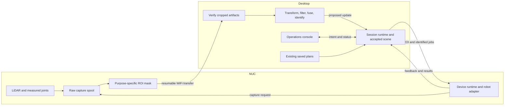

# Excavator migration: current implementation plan

Consolidated on 2026-09-09. This is the current ordering and scope for the
remaining migration. The [online architecture](excavator-online-architecture.md)
is its detailed interface reference. The earlier
[offline migration plan](stacking-planner-migration-plan.md) and
[code audit](excavator-code-audit.md) retain implementation and review history.

## Objective and fixed decisions

Deliver excavator perception, execution and operations for the commissioned
VDK23 with **stone_grab only**, using
`apps/excavator/assets/stone_grab_3/stone_grab.urdf`.

1. Implement **perception → execution → operations**, then address further
   planning work separately.
2. The desktop owns expensive point-cloud processing, accepted scene state,
   the execution workflow and the operations UI.
3. The NUC owns acquisition, capture-time device metadata, lightweight spatial
   cropping, local buffering and the single robot-command adapter.
4. Transfer task-relevant cropped data over the greater-than-30 m WiFi link.
   Preserve original frames locally for wider recropping and diagnostics.
5. Preserve tabletop behavior. Reuse common numeric workflows and contracts;
   keep excavator sensor, robot, ROS and operator policy in its application.
6. Keep existing legacy hardware topics behind adapters during migration.
   Replace implicit phase/flag coordination with identified jobs and results.
   Do not add other gripper models, gripper plugins or a new controller
   framework as prerequisites.

## Starting point

| Area | Status |
| --- | --- |
| Shared contracts and tabletop migration gate | Implemented and previously validated. |
| Excavator offline search, native planning adapter and saved-run replay | Implemented; broader planning acceptance and numerical comparisons remain deferred. |
| Five audit defects | Fixed: committed observations/rewards, rendering dependency boundary, target taper, scan orientation and explicit immutable resume inputs. |
| Latest combined fix verification | 222 focused tests passed, including tabletop regressions. This is historical test evidence, not a new full-suite or hardware validation. |
| Excavator desktop perception, simulated execution and session operations | Implemented and tested without a NUC; live device services remain pending. See [simulation workflow](excavator-simulation.md). |
| Desktop PCD emulation | Implemented: legacy ray fixtures, purpose crops, capture contracts, local interrupted-transfer checks and PLY exports. See [commands and limits](excavator-pcd-emulation.md). |
| Desktop perception and capture delivery boundaries | Implemented: recorded/legacy import, measured reference catalog, field/in-hand ICP, scene reconciliation proposals, replay review, bounded stationary service and rsync staging adapter. [Acceptance limits and commands](excavator-perception.md); live ROS/WiFi commissioning remains pending. |
| stacking-core session changes | Committed as `0c2864d`: excavator IK exposure and motion failure diagnostics. |

The operations console now includes Perception, Execution and History tabs
for a durable desktop simulation session, alongside Plan and Search Inspector.
Live sensor jobs and physical device commissioning remain separate work.

## Runtime and data flow

### Clarified emulation target — 2026-09-10

The required emulation is an ongoing desktop → virtual NUC → virtual world →
desktop perception loop. All components can run on the desktop without a
physical NUC. This integration is now implemented for a committed placement:
measured motion updates the world, in-hand and scene captures trigger desktop
identification, and revision-checked reviews continue or invalidate execution.
The Execution tab renders live state and provides review/fault controls. See
[closed-loop emulation](excavator-closed-loop-emulation.md) for commands,
verification bounds and software-emulation limits. Physical commissioning and
further planning-algorithm work remain deferred.

Acceptance requires all of the following in one running scenario:

1. Desktop execution sends motion, gripper and capture requests through the
   virtual NUC interface and receives acknowledgements and simulated feedback.
2. A shared virtual world updates the excavator, stone_grab and individual
   stones through pickup, carrying and placement. Capture requests generate
   PCD from that current world and capture-time sensor/gripper transforms.
3. The virtual NUC retains raw captures and returns purpose-specific cropped
   products and metadata. Desktop workers identify poses from those products,
   apply the review policy and use accepted results to continue or invalidate
   execution. Loading a pre-generated file manually is not the acceptance case.
4. The Execution window renders the current simulated excavator and stone
   states. World truth used for emulation/debug rendering remains distinct from
   the poses estimated by perception; identification must consume simulated
   sensor evidence rather than receive the world's stone poses as its answer.

Use the same command/capture contracts intended for the physical NUC, while
retaining desktop-heavy processing, purpose-specific crops and transfer-failure
tests. Scope remains VDK23 with stone_grab. Complete this software loop before
physical ROS/NUC commissioning; further planning-algorithm work stays deferred.

The architecture below describes the eventual device deployment. The virtual
NUC and virtual world must first exercise its command and observation paths
locally.



There are three independent state owners: immutable planning artifacts,
desktop-owned accepted scene revisions, and NUC-owned measured device state.
Perception workers propose updates; only the desktop session runtime accepts
them. GUI clients cannot mutate scene state or publish robot commands directly.

Maintain distinct records for the source capture, each derived crop product,
perception results, accepted scene revisions and execution attempts. Bind them
with IDs, hashes, timestamps and provenance. A retry of an interrupted transfer
uses the same product ID; it never repeats physical acquisition or motion.

Keep execution-session history separate from the source planning `.stack`
document. Reuse existing common artifact codecs and command/event contracts;
add versioned records only where the online workflow needs them. The desktop
session runtime is the sole journal writer. The NUC keeps a local job journal
and bounded raw/cropped artifact spool for reconnect and recovery.

## Phase 1 — perception and capture delivery

### 1A. Recorded inputs and frame contracts

Create portable fixtures from legacy field, in-hand and scene captures. Record
sensor and joint timestamp provenance, original sensor frames, calibration,
model identity, object IDs and expected identification behavior. Use existing
commissioned stone_grab geometry and catalog assets.

Implement a capture importer and pure data contracts for capture manifests,
crop descriptors/products and proposed scene updates. Reuse array transforms,
registration and reconstruction utilities from common code as applicable.
Document explicit world/stack/sensor/gripper frame relationships. In-hand
processing must preserve the commissioned gripper geometry-frame offset;
the legacy bare link frame is not an interchangeable substitute.

**Acceptance:** fixtures load without ROS or the legacy applications; rotated
frame tests catch double transforms and wrong gripper offsets; malformed IDs,
missing calibration and stale/insufficient timestamp evidence are reported.

### 1B. Desktop identification and purpose-specific ROI policy

Implement the recorded-data pipeline in this order: field PoseID, in-hand
PoseID/opening estimation, then placed-scene identification and reconciliation
proposals. Use desktop workers for transforms, fine cropping, denoising,
voxelization, fusion, normals, segmentation and ICP. Keep heavy work outside
the session and UI event loops. New model reconstruction is not a prerequisite
for identifying the existing commissioned catalog.

| Scan purpose | Desktop-defined transfer region | NUC work |
| --- | --- | --- |
| Scene identification | Target structure plus expected/observed stones, overhang, displacement margin and necessary ground/support context. | Apply a generous spatial box mask per sensor frame. |
| In-hand pose identification | stone_grab jaws plus held-stone envelope, including opening and pose uncertainty. | Resolve the gripper-relative crop at capture time and retain selected original sensor rows. |
| Field identification / failed-grasp recovery | Region around the plausible object location, expanded for size and prior uncertainty. | Apply the requested field-region mask. |

Keep point density and attributes within the ROI unchanged. The NUC does not
run registration, segmentation or mesh-based gripper removal. Implement the
numeric box mask once and compare its NUC adapter with the desktop reference.
Crop parameters carry a frame, version, calibration hash and explicit margins.
Do not clip scene data exactly to the desired tapered structure.

Perception results carry IDs, source crop/capture, scene revision, frame,
metrics, ambiguity and validity. In-hand results carry `gripper_T_object` and
estimated opening with separate validity from measured device opening. Sparse
or empty crops mean insufficient evidence, not confirmed object absence or
grasp failure. Request a wider crop of retained raw data when appropriate.

**Acceptance:** compare cropped and uncropped fixture results, including
overhang, open/closed jaws, uncertain priors, occlusion and rejected registration.
Proposed updates cannot overwrite a newer scene revision.

### 1C. NUC acquisition and reliable delivery

Implement identified capture jobs, local raw retention, immutable crop
products, per-frame transfer and durable desktop verification. Use the public
job interfaces in the architecture reference; recropping retained data is a
separate operation that cannot trigger physical scanning.

Start with recorded/simulated streams and passive or stationary live capture.
**Moving scan choreography depends on the execution owner in Phase 2** and is
enabled there. Perception-first does not create a second temporary joint-command
publisher or require copying the legacy motion loops into acquisition.

For the WiFi link:

- Transfer cropped binary frames incrementally, with retained partial files,
  bounded retries and staging that processing cannot see before verification.
  Start with the proposed SSH/rsync adapter, subject to host availability.
- Verify product/frame identity, byte counts and hashes, then acknowledge a
  durable product receipt. A crop acknowledgment does not establish a desktop
  backup of the raw source.
- Retain raw captures through perception review and the recrop retention
  window. Reserve storage assuming zero upload progress; defer new work when
  capacity is unavailable instead of silently evicting pending raw data.
- Bound transfer concurrency and bandwidth. Suspend bulk traffic if control
  freshness degrades. Measure actual link behavior at operating distances and
  machine orientations; separate queues do not guarantee shared-radio capacity.
- Separate acquisition, delivery and perception completion. A lost result is
  recovered by job ID; a slow upload never extends the robot's control lease.

**Acceptance:** interrupted transfers and lost acknowledgments resume without
recapture; corrupted/incomplete products never enter accepted perception;
recropping preserves source identity; queues/spools stay bounded during
outages; capture-time joints are used even after delayed network delivery.

**Phase 1 outcome:** a CLI-driven capture/import → crop/transfer → desktop
identification → reviewable scene-update pipeline, independent of a finished UI
or new planning algorithms.

## Phase 2 — execution and supervised scan motion

### 2A. Execution runtime against simulated devices

Implement a desktop session/execution state machine and a NUC device runtime.
The NUC robot adapter is the only actuator command owner. Pick/place motion,
scan postures and manual adjustment all pass through it. Use existing saved
plans and recorded direct/regrasp phase/event fixtures.

Implement validated command dispatch, measured convergence, gripper gates,
operator decisions, hold/cancel, lease renewal, journaled outcomes and restart
reconciliation. Keep degree/radian conversion, signs, wrapping and stone_grab
open/close/stay codes inside the legacy device adapter.

```text
ready → pick → grasp/in-hand verification → review → place
      → scene capture → reconciliation → ready

invalidated next motion → needs_replan
lost ownership or uncertain physical outcome → hold/reconciliation required
```

If perception changes attachment or scene geometry enough to invalidate the
next motion, stop at `needs_replan`. Define the existing planner adapter's
boundary, but do not implement automatic replanning or change planner algorithms
in this phase. This may limit an integrated run until the later planning work.

**Acceptance:** command identity and ordering, stale/duplicate decisions,
invalid plans, measured-state mismatch, gripper uncertainty, delayed feedback,
disconnects and process restarts are covered. A send acknowledgment is never
treated as physical completion; reconnect never resumes motion automatically.

### 2B. Device integration and acquisition choreography

Connect the current joint/feedback transport behind the new adapter. Verify
local device feedback before motion. Route field, in-hand and scene scan
recipes through the same owner, then combine them with the Phase 1 pipeline.
Legacy scan scripts cannot remain competing publishers.

Confirm controller stop/watchdog behavior, joint limits, timing, calibration,
gripper feedback and representative validated motion/workspace clearance before
physical dispatch. The current planning model's absence of robot-body collision
geometry remains a known limitation; this execution adapter does not certify
arbitrary saved trajectories. Use independently validated motion cases, and
record any commissioning work that must wait for planning.

**Acceptance:** first telemetry and stationary capture, then supervised bounded
device jobs using a CLI. Demonstrate local hold on control-lease loss, retained
capture data after interrupted scans, explicit recovery, and no competing
actuator writer. Do not substitute WiFi reconnection for operator reconciliation.

**Phase 2 outcome:** headless execution and moving acquisition through one
device owner, with durable feedback and recovery behavior. Physical acceptance
is reported separately from simulated-device test results.

## Phase 3 — operations console

Connect the existing excavator console to the session runtime. Keep Plan and
Search Inspector, including current DSF/PLY and rendering controls. Add:

| View | Behavior |
| --- | --- |
| Perception | Capture/transfer progress, sensor/frame health, crop overlays and retained counts, registration quality, pose differences, wider recrop/raw retrieval, accept/reject. |
| Execution | Measured versus planned state, active phase, feedback freshness, grasp status, hold/resume/cancel and recovery decisions. |
| Session history | Linked planning inputs, captures, crop versions, accepted scene revisions, operator decisions and execution events with replay/export. |

Every UI intent enters the desktop runtime. Decisions carry an active token
and scene revision; stale dialogs cannot authorize a newer operation. Reopening
the UI recovers the current session instead of creating a new execution attempt.
Show requested, confirmed-held and unknown states distinctly. Render measured
data with its validity and timestamp separately from planned ghosts.

**Acceptance:** end-to-end recorded/simulated sessions through the UI, reconnect,
stale decision rejection, incomplete transfer display, crop retries, and
responsive controls under cloud-processing/network load. Repeat tabletop GUI
regressions for any shared rendering change.

**Phase 3 outcome:** operators can inspect and supervise the Phase 1/2 runtime
without needing the CLI. Underlying execution state is independent of the UI.

## Later work and exclusions

After these areas, return to longer MCTS acceptance, reward/simulation
comparisons, fresh grasp/direct/regrasp success, remaining planning policy
differences and perception-driven replanning. Training/learned models and broad
research tooling are outside the current sequence. Other gripper models remain
excluded. No planner upgrade, model plugin system or ROS distribution upgrade
is bundled into the perception/execution/operations implementation.

## Implementation ownership and review units

Keep reusable array algorithms and artifact/command values in `stacking-common`.
Put excavator policy in `apps/excavator/{acquisition,perception,execution,runtime,ros}`
under its Python source package, its operator views under `gui/operations`, and
generated ROS interfaces/launch files under the platform app. No ROS, sensor
driver or platform imports enter common numeric workflows.

Deliver reviewable units in this order:

1. Recorded capture fixtures, frame/calibration values and versioned manifests.
2. Purpose-specific ROI construction/masking and desktop identification.
3. Raw retention, crop products, resumable transfer and stationary acquisition.
4. Session runtime, execution state machine and simulated device ownership.
5. Legacy device adapter, moving scan choreography and commissioning cases.
6. Operations views, runtime client, reconnect and integrated replay.

For each unit, use legacy behavior fixtures where relevant, failure-path tests
for state or persistence changes, and focused tabletop regressions for common
changes. Keep legacy repositories as references until replacement acceptance
passes. Do not rerun native search or the whole suite for documentation-only
changes. Field measurements and hardware commissioning are explicit evidence
categories; no fixed bandwidth, latency or effort estimates are assumed.

**Current implementation (steps 1–4):** legacy field ground retention and crop
ordering are restored; a portable recorded regression reproduces the saved
legacy pose to numerical precision. The existing target-coverage gate rejects
that particular result (28.9% versus 35% required), so numerical parity is not
reported as physical acceptance. Six recorded in-hand views from two sessions
exercise bounded per-view gripper alignment; two recorded scene regions exercise
unobserved-object rejection. Controlled model scenes cover positive reconciliation.

A single-owner, journaled simulated executor now exercises direct/regrasp paths,
measured completion, hold/cancel, lease and feedback faults, restart recovery,
and perception-driven `needs_replan`. Operations integrates background PCD
identification, proposal/ROI visualization, revision-checked decisions, simulation
controls and persistent history. See [commands and precise limits](excavator-simulation.md).

Next, implement the complete virtual NUC/world loop defined above, including
command-triggered scans and moving stones in the Execution view. Then commission
concrete ROS capture and the physical NUC adapter, measure field WiFi behavior,
and validate physical pose accuracy. Further planning work remains deferred.
