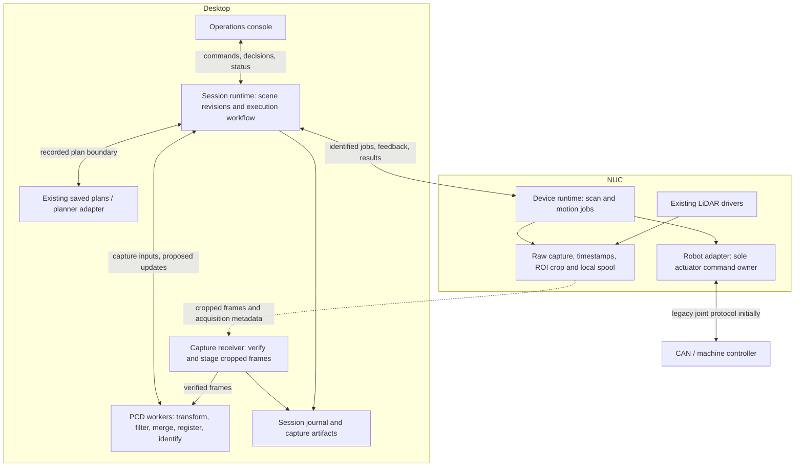

# Excavator perception, execution, and operations design

Proposed on 2026-09-09. This is the interface/design reference for the
[current overall implementation plan](excavator-implementation-plan.md), not a
description of deployed services. Implement perception, then execution, then
operations. The five defects in the [code audit](excavator-code-audit.md) have
been fixed. Further MCTS, grasp-search, and motion-planner development is deferred
at the user's request.

A [desktop PCD emulation harness](excavator-pcd-emulation.md) now exercises
capture frames, purpose crops and interrupted local delivery without a NUC.
Its simulated inputs and local receiver do not constitute deployed services.
The [desktop perception implementation](excavator-perception.md) adds recorded
imports, identification/review and tested acquisition/delivery boundaries;
its acceptance limits are documented separately from this proposed live design.
The [desktop execution simulator and session console](excavator-simulation.md)
now implement the next software milestone. They are not deployed NUC/ROS services.

Gripper scope: **stone_grab only**, using the commissioned
`apps/excavator/assets/stone_grab_3/stone_grab.urdf`. Perception crops, opening
estimation, contact geometry, execution and operations use this model. Other
grippers are outside the current work; do not add gripper selection, model
plugins or interchangeable-gripper abstractions. References to attachment
state below mean the held stone's relation to this gripper.

Deployment constraint: desktop and NUC communicate over WiFi at more than
30 m separation. Design capture delivery to tolerate variable throughput and
connection loss. Distance alone does not establish usable bandwidth, latency,
or outage duration; measure these at the actual operating positions.

## Recommended structure

Keep one desktop session runtime responsible for accepted scene state and the
execution workflow, and one NUC device runtime responsible for commanding the
machine. Make the operations console a client of the desktop runtime. The
desktop has substantially more compute than the NUC, so run expensive
point-cloud processing there, in separate workers that return proposed scene
updates. To reduce traffic over the field WiFi link, the NUC applies a lightweight
purpose-specific spatial crop before transfer. It also handles acquisition and
local control. ROS adapters
translate explicit job and result values at process boundaries; array
algorithms and persisted records stay independent of ROS.



These are a few process boundaries chosen for ownership and responsiveness.
Do not create a separate ROS node or package for each algorithm. The NUC robot
adapter and lightweight capture coordination can share the device-runtime
process initially; sensor driver processes remain external. Spool I/O and
artifact transfer run outside control callbacks with bounded queues. Neither
point-cloud processing nor bulk transfer may block the control event loop.

## Compute placement

| Work | Host | Boundary |
| --- | --- | --- |
| LiDAR driver, raw capture, timestamps and joint-feedback association | NUC | Preserve original sensor frames locally with acquisition metadata. |
| Scan postures, dwell verification, gripper/robot commands and watchdogs | NUC | Keep device responsiveness independent of desktop processing load and network latency. |
| Transfer ROI selection | Desktop | Choose a conservative region for the perception task, with explicit frame and uncertainty margins. |
| Transfer ROI mask | NUC | Apply capture-time transforms and simple box tests to each sensor frame; preserve retained point attributes. |
| Raw-frame spool and cropped-frame transfer | NUC → desktop | Keep originals locally for recropping; send the required spatial subset in the background. |
| Coordinate transforms, fine cropping, voxelization and outlier removal | Desktop | Apply recorded calibration and capture-time joint state to received data. |
| Multi-sensor fusion, normals, segmentation, ICP, PoseID and SceneID | Desktop | Use bounded CPU worker parallelism; avoid competing with the session/UI event loops. |
| Mesh/DSF reconstruction, quality checks, rendering and scene acceptance | Desktop | Reuse common algorithms; the session runtime alone accepts scene revisions. |

The NUC does not need registration, reconstruction, or perception-model loading
to acquire and crop a scan. Keep those dependencies out of its runtime import
path. Beyond acquisition, perform only transport validation, sensor decoding,
and the explicit ROI mask there. The desktop sends the box geometry; the NUC
does not need to load object meshes or estimate poses to choose it. Preserve
retained sensor attributes, including intensity or per-point timing when
supplied by the driver.

Generate visualization previews on the desktop from received data. Do not add
NUC denoising, clustering, downsampling, or compression by default to reduce transfer size.
If measured network capacity becomes the bottleneck, evaluate lossless
compression or a smaller acquisition workload against NUC CPU cost and capture
quality before changing that boundary. GPU use is a later optimization only
where the chosen algorithm supports it; desktop execution does not depend on it.

### Purpose-specific transfer crops

| Purpose | ROI frame and extent | Required context |
| --- | --- | --- |
| Scene identification | Box enclosing the target structure and expected/observed stone envelopes in stack/world coordinates. | Include placement overhang, expected displacement, surrounding supports and a ground band needed for registration; do not clip precisely to the ideal tapered target. |
| In-hand pose identification | Box in the commissioned stone_grab frame enclosing its jaws and expected held stone. | Include uncertainty in object pose and stone_grab opening, and jaw surfaces needed for opening/attachment estimation. A gripper-only box may cut off the stone. |
| Field pose identification / failed-grasp recovery | Box around the object's last plausible field location in world coordinates. | Include object size and localization/displacement uncertainty. Widen the search region when the prior is weak. |
| Object/gripper reconstruction or diagnostics | Explicit calibration/reconstruction region appropriate to the acquisition recipe. | Preserve surfaces required by that workflow; full raw frames can be requested when there is no justified ROI. |

The desktop specifies a versioned crop descriptor: purpose, object IDs,
reference frame, box pose, half-extents, per-axis margins, scene revision and
calibration hash. Resolve the margins from the scan purpose, object envelope,
and measured calibration/pose uncertainty. Do not invent one universal margin
or infer successful identification merely because some points remain.

For each sensor frame, transform the ROI into that sensor's coordinates using
capture-time joint state and calibration. A rotated box can be represented by
six half-spaces: test the original XYZ points against those planes with NumPy
in bounded batches. This avoids per-point ICP, normals, mesh work, or creating
a full transformed point-cloud copy on the NUC. For a gripper-relative ROI the
transform changes with measured robot pose; recompute it per captured frame.
Keep selected points in their original sensor frame and record the exact crop
transform, so the desktop performs its final frame conversion exactly once.

Commission the in-hand ROI frame explicitly. Legacy
[`to_gripper_frame`](../../stacking-planner/scripts/nuc/pose_identification.py)
uses the first `grip_body` geometry frame, which has a fixed offset from the
bare link frame. Preserve that transform when adapting it to the new model;
the legacy code warns that substituting the link frame can move the crop off
the held stone. Record a named frame and its calibrated transform instead of
implicitly choosing a geometry by array index in the new implementation.

Cropping changes membership only; it does not reduce point density within the
ROI. Keep gripper removal, ground removal, clustering and fine object masks
on the desktop. Reject missing/stale transforms rather than applying a box in
the wrong frame. Report raw/retained point counts and bytes per sensor, the
crop bounds and transform, and boundary proximity for desktop quality review.
An empty crop is recorded explicitly, not silently omitted from the frame set;
it is not by itself proof that an object is absent or a grasp failed.

Preserve uncropped frames in the bounded NUC spool. If the desktop sees a
truncated object or insufficient coverage, it can request a wider crop from
the same capture without moving the robot or scanning again. Give each derived
crop a distinct product ID and immutable manifest linked to raw-frame hashes
and the crop descriptor hash. Original coordinates/attributes of selected
points remain unchanged. Changing the crop must never overwrite an artifact
already used by an accepted perception result. Explicit raw retrieval is also
available while the source remains retained; report `raw_unavailable` after
expiry rather than silently acquiring a replacement scan.

## Why change the legacy organization

The legacy [`PlanningWorker`](../../stacking-planner/planning/execution.py)
combines scene mutation, robot control, acquisition, perception, recovery,
logging, and viewer behavior through execution mixins. NUC scan scripts also
publish joint commands themselves. This makes ownership depend on which
script is currently waiting or polling.

Specific interface limitations observed in the local code:

| Current path | Limitation | Replacement |
| --- | --- | --- |
| `/phase`, `/log_dir`, scan-request topics | A logical request is spread across independently arriving messages. | One typed scan goal carrying its request ID and inputs. |
| `/scene_pcd`, `/scene_pcd_done` and `/scene_scan_done` | Different callers use different completion topics; clouds from several scan purposes share a stream. | Capture ID, frame sequence, explicit expected-frame manifest, and one terminal job result. |
| `scene_base_*` and other labels in cloud `frame_id` | Coordinate frames and artifact names are mixed. | A real coordinate frame in the header; capture labels in separate fields. |
| `/grasp_status` Bool and pose topics | Object identity, request association, and timing are not consistently carried together. | Identified perception results with object ID, source capture, timestamp, and validity. |
| `/joint_ctrl` from desktop and NUC routines | Different workflows can become actuator command publishers. | All motion goes through the NUC robot adapter and one exclusive command owner. |
| Shared scene and GUI worker state | GUI lifecycle and physical-session lifecycle are coupled. | Durable runtime state with a reconnectable UI client. |

Sources: legacy [`joint_node.py`](../../stacking-planner/ros2/joint_node.py),
[`sceneid_node.py`](../../stacking-planner/ros2/sceneid_node.py),
[`execution_perception.py`](../../stacking-planner/planning/execution_perception.py),
[`execution_scene_scan.py`](../../stacking-planner/planning/execution_scene_scan.py),
and [`pose_identification.py`](../../stacking-planner/scripts/nuc/pose_identification.py).

## Code ownership and proposed layout

```text
packages/stacking-common/src/stacking_common/
  pointcloud/             existing array acquisition/registration contracts
  reconstruction/         existing reusable geometry algorithms
  execution/              existing command/event/result contracts
  artifacts/              versioned codecs, scene/capture/execution records
  visualization/          canonical headless scenes and projection

apps/excavator/src/stacking_excavator/
  acquisition/            capture jobs, scan choreography, calibration binding
  perception/             field/in-hand/scene identification policy
  execution/              sequence state machine, gates, reconciliation
  runtime/                desktop session owner and NUC device owner
  ros/                    conversions, nodes/clients, legacy device adapter
  gui/operations/         perception/execution views and runtime client
  planning/               existing planner; no algorithm changes in this phase

apps/excavator/
  ros_interfaces/         ament package stacking_excavator_interfaces
    msg/ srv/ action/     only contracts that cross ROS process boundaries
  launch/                 separate desktop, NUC, and simulation launch files
  config/
    perception.yml        registration/acceptance policy in physical units
    acquisition.yml       sensors, scan postures, capture limits
    execution.yml         commissioned limits, feedback and gate policies
    calibration.yml       explicit measured transforms and provenance
    ros.yml               names, QoS, namespace and legacy mappings
```

Add files only when their implementation stage needs them. Keep the ROS
interface package platform-owned instead of adding ROS imports or generated
message dependencies to `stacking-common`. Plain common values may be reused
inside messages through conversion; they do not import the generated classes.
Move an algorithm from tabletop only with its characterization tests and an
actual excavator caller. Do not import tabletop hardware or GUI packages.

Build `stacking_excavator_interfaces` through the ROS workspace/colcon overlay;
install excavator Python logic through the existing project packaging. Online
entrypoints load ROS extras explicitly. Existing offline CLI and replay remain
usable without sourcing ROS. Jazzy is installed on this development host; the
deployed NUC distribution and vendor-driver compatibility must be checked
before choosing the deployment lockfile. This plan does not require a ROS
distribution upgrade or a rewrite of the CAN driver.

## State ownership and records

Use three distinct forms of state:

1. **Planned state:** existing immutable plan and planning-context hashes.
2. **Observed scene:** versioned accepted object poses, attachment state,
   calibration identity, and evidence from perception.
3. **Device state:** timestamped measured joints, gripper feedback, active job,
   and controller health. The NUC owns the authoritative device observation.

The desktop runtime is the sole writer of accepted scene revisions and its
session journal. Perception returns a proposal based on a specific revision;
accepting it requires that revision still to be current. Missing objects stay
unknown until reconciled; a successful planner result never becomes measured
execution success automatically. In-hand identification updates an attachment
estimate; it does not insert the held object back into the field scene.

Each job carries `session_id`, `request_id`, `scene_revision`, calibration and
model hashes, and the relevant object ID. Each event carries a producer boot ID
and monotonically increasing sequence. A transport retry uses the same request
ID and payload hash; a deliberate new physical attempt uses a new ID. Store
accepted requests before dispatch and terminal outcomes before returning them.
Do not claim exactly-once physical execution: after a crash with uncertain
outcome, query the device journal and reconcile instead of replaying a command.

Reuse `.stack` codecs and execution records where they fit, but create a
separate execution-session document referencing the immutable planning run.
This avoids concurrent planning and live-execution writers in the same SQLite
file. Version any added capture/scene records, retain old readers' supported
behavior, and test reference and hash validation. The NUC has a small local
job journal and capture spool, not another mutable copy of desktop scene state.

## Perception and capture interfaces

Proposed minimal public ROS API under `/excavator`:

| Interface | Kind and owner | Input → outcome |
| --- | --- | --- |
| `submit_command` | Short service, desktop runtime | Identified UI/CLI intent (start capture, select plan, execute next, manual adjustment, hold/resume/cancel) with expected scene revision → accepted command ID or rejection; progress through session state. All UI intents enter here, never directly at NUC jobs. |
| `acquire_scan` | Action, NUC device runtime | Capture ID, kind (field/in-hand/scene), object IDs, crop descriptor, named scan recipe, calibration hash → acquisition progress, source manifest and initial cropped-product manifest. Desktop selects the ROI; NUC applies it. |
| `prepare_capture` | Action, NUC capture worker | Existing capture ID and a new crop descriptor or explicit raw retrieval → immutable transfer-product manifest. Reads retained data only; never commands motion or repeats acquisition. |
| `execute_motion` | Action, NUC device runtime | Identified validated execution segment group, joint order, timing, gripper events, context hash → measured progress and terminal result. |
| `control_job` | Short service, NUC | Active job ID plus hold/resume request → accepted/rejected; completion comes through job status. Use the action cancellation API for cancel. |
| `get_job` | Service, NUC | Request ID → durable status, outcome and artifact references; supports reconnect after result-cache expiry. |
| `ack_capture` | Short service, NUC | Capture/product IDs and final product-manifest hash → idempotent durable receipt acknowledgment. Acknowledges only the transferred product; raw retention has its own acceptance/expiry gate. |
| `renew_control_lease` | Short service, NUC | Desktop boot/session identity and current lease token → exclusive ownership token and validity duration, or rejection. Each physical job is bound to this owner. |
| `device_state` | Topic, NUC | Stamped canonical joints, opening/status validity, active job and health. |
| `session_state` | Topic, desktop runtime | Current workflow state, scene revision, pending decision and active job IDs. |
| `decide` | Short service, desktop runtime | Decision token, expected scene revision, accept/reject/continue/abort → recorded acceptance or stale-token rejection. |

Use actions for scans and bounded motion because they provide goal identity,
progress, cancellation, and terminal results. Services handle short decisions
and queries; topics carry observations. These choices follow the
[ROS 2 action model](https://design.ros2.org/articles/actions.html). Names and
schemas above are proposed application interfaces, not existing ROS standards.

Perception runs locally on the desktop through a plain callable/job interface,
starting with transforms and fine filtering of purpose-cropped sensor data.
There is no need to expose every ICP call as a ROS service. Its
result includes source capture ID, requested object IDs, output frame, candidate
poses, fitness/RMSE/inlier metrics, ambiguity or missing-object results, and
the calibration/model hashes used. Thresholds belong to excavator profiles.
Do not treat an ICP optimizer returning as an accepted identification.

For in-hand mode, return `gripper_T_object` and the estimated gripper opening
together, with validity and source for each. Preserve the distinction between
that perception estimate, commanded opening, and measured device opening.
The accepted attachment geometry uses the validated pair; a missing opening
estimate is an explicit unavailable value, not an invented measurement.

NUC capture jobs must produce immutable manifests containing sensor IDs, frame
sequences, sensor and receipt timestamps, associated measured joint samples
and their timestamp provenance, dwell intervals, raw-cloud references and
hashes, and calibration identity. Desktop processing records add transformed
cloud references, processing-profile hashes, and the exact transforms used.
Derived transfer manifests additionally bind the crop descriptor and version,
raw-frame hashes, retained-frame hashes, and per-frame point/byte counts.
Use canonical `parent_T_child` notation, SI units, and XYZW quaternions. Apply
the stack/world transform exactly once. Preserve raw data so a calibration or
registration correction can be replayed without acquiring another scan.
Desktop transforms use the joint state associated with capture, never the
latest joint feedback at network-arrival time.

The local `tp_msgs/CtrlJoint` and `PoseWithId` definitions do not contain a
header timestamp. A receipt timestamp added by an adapter is not a sensor
timestamp. Initially accept captures only at verified stationary dwell poses
with bounded feedback age and documented clock uncertainty; do not claim
motion-synchronized clouds until the source feedback path supplies adequate
timing. Frame labels must resolve to a recorded transform at capture time;
missing or stale transforms fail the capture.

Keep full-resolution raw clouds in a bounded NUC capture spool. Transfer each
immutable cropped frame as soon as its write completes through one
artifact-transfer
adapter (initial deployment: SSH/rsync if available, with configured roots).
Verify frame identity and hashes on the desktop, then process that frame while
the NUC acquires subsequent dwell poses. Publish the final product manifest
with the required cropped-frame set when acquisition and cropping finish.
No arbitrary desktop
path is sent for the NUC to interpret as a local path. Interrupted transfer
retries a capture/product/frame ID, not another physical scan.

Keep `acquisition_complete`, `transfer_verified`, and `processing_complete`
distinct. Incremental filtering, fusion, and registration may run before the
last frame arrives, but scene acceptance waits for all required frames and a
validated final result. Disposable previews may drop frames; authoritative
capture data must never silently omit them. Report incomplete capture when
storage or acquisition fails, and preserve the available evidence.

Bound transfer concurrency, bandwidth, desktop processing queues and NUC spool
capacity. Check storage before accepting a scan and again between dwell poses;
defer new capture work under backpressure instead of growing buffers without
limit. Bulk transfers share network capacity with ROS: separate queues or
connections alone do not reserve capacity for feedback, lease renewal and
hold/cancel. Commission bandwidth limits under simultaneous traffic. A transfer
acknowledgment permits cleanup of that derived product according to retention;
it does not assert that the uncropped source exists on the desktop. Retain raw
captures through perception review and the configured recrop window, or until
an explicitly recorded expiry/discard decision. Defer new captures when
retention consumes the reserved capacity instead of silently evicting pending
source data.

### Transfer over the field WiFi link

Use local capture followed by resumable delivery as the baseline. The desktop
coordinates one bounded bulk-transfer worker initially. Keep full PCD payloads
out of the ROS job/control topics: those carry small requests, status and
artifact descriptors. Transfer purpose-cropped sensor frames individually, rather than
one large merged scan that must be recreated after interruption. The desktop
can process verified frames incrementally without requiring continuous video-
rate PCD streaming across the link.

Start with SSH/rsync using a private partial directory, transfer-rate limit and
I/O stall timeout. Rsync supports retained partial data for subsequent retries;
its I/O timeout is a stall limit, not an overall completion deadline. Configure
SSH connection timeout separately; rsync's `--contimeout` applies to its daemon
transport. Confirm installed versions and behavior in the transfer harness.
See the [rsync manual](https://download.samba.org/pub/rsync/rsync.1).
The following integrity and retry behavior belongs to our capture protocol,
not to rsync alone:

1. The NUC closes and durably publishes an immutable cropped frame and descriptor
   containing capture/product IDs, crop hash, source-frame hash, sensor/frame
   sequence, byte count and SHA-256. A file
   still being written is not available for transfer.
2. The desktop receives it into a private staging area. Partial files are not
   visible to processing workers. Connection loss retains the partial transfer;
   retry the same immutable frame with bounded backoff instead of requesting
   another capture. Do not rely on file size/mtime equality for verification.
3. After complete byte-count/hash validation, the desktop durably promotes the
   frame into its capture store and records receipt. Repeated descriptors or
   transfers of the same ID/hash reuse it. Different bytes for an existing ID
   are an error rather than an overwrite.
4. The final product manifest identifies the complete required cropped-frame
   set. Once all files and the manifest are durably verified, the desktop
   acknowledges capture/product IDs and the manifest hash. The NUC persists
   that acknowledgment before applying derived-product retention, while
   preserving the raw-source retention gate. A lost acknowledgment is retried
   idempotently; neither
   rsync exit success nor a desktop preview permits deleting source data.

Transfer progress, not assumed WiFi speed, drives the UI. Show verified frames
and bytes, queued bytes, last successful progress, retry state and local spool
capacity. Show an ETA only while measured throughput supports an estimate.
Keep four deadlines distinct: physical acquisition, connection setup, transfer
stall, and the workflow's wait for perception. Exhausting a delivery retry
budget leaves a resumable `delivery_pending` capture and pauses the dependent
workflow; it does not mark capture as successful identification or delete it.
If the scan's terminal action response is lost, query `get_job` using the
original request ID and recover its manifest instead of submitting a new scan.
Never lengthen the robot control lease merely to accommodate a slow download.

Apply a conservative bulk-transfer cap based on measured low-throughput conditions
and test it with simultaneous ROS feedback. If feedback age or lease round-trip
latency exceeds its commissioned budget, suspend bulk work and resume it only
after control communication recovers. Small metadata/result messages take
precedence over bulk frames; unnecessary previews and background diagnostics
are deferred first. Separate connections and DDS QoS do not provide physical
radio isolation. This is congestion management, not a guarantee that control
messages can cross a failed link.

Reserve enough NUC spool space for the admitted scan without assuming any
concurrent upload succeeds, including raw sources and derived crops. Bound
samples/bytes per recipe and check both NUC
and desktop capacity. If space cannot be reserved, defer that capture; if a
sensor exceeds the bound, fail the capture explicitly and preserve its partial
evidence. Do not overwrite unacknowledged data to make room. Encode retained
sensor attributes in binary rather than ASCII PCD/PLY; test lossless compression only
if its bandwidth saving outweighs NUC CPU and latency cost.

If WiFi disconnects, local buffering preserves already acquired data. It does
not authorize the NUC to continue a moving scan after its control lease expires:
the device runtime follows the existing hold/reconciliation policy and marks
an unfinished scan incomplete. Retained captures can be cropped and transferred while
execution is held. Reconnection can resume file delivery automatically; renewed
robot motion still requires valid ownership and explicit reconciliation.

Acceptance tests must interrupt a file transfer, lose the final acknowledgment,
restart either transfer process, corrupt/truncate a staged file, reorder or
duplicate descriptors, exhaust disk capacity, and delay required frames. Verify
that none of these cases commits an incomplete scene or repeats physical motion.
Exercise bandwidth collapse and repeated WiFi outages while checking measured
control latency, hold behavior, bounded spool growth and recovery. Pick rate,
timeout and retention values only after field measurements; no numeric link
capacity is assumed in this plan.

## Execution and NUC control

The desktop execution state machine coordinates bounded device jobs:

```text
ready → pick → verify grasp / in-hand capture → review
      → place → scene capture → reconcile → ready

any active state → hold requested → held (only after device confirmation)
any uncertain outcome → reconciliation required
```

Use existing successful saved motion plans for implementation and testing.
If measured in-hand pose or observed obstacles invalidate the next motion,
enter `needs_replan` and stop advancing. Define the planner input/output hook,
but leave automatic replanning and planner improvements for the later planning
work. Do not continue an old trajectory merely because that work is deferred.

The NUC accepts one resource-owning motion or scan job at a time. Scan recipes
request moves through the same robot adapter used by execution. Manual
adjustment also passes through this owner and invalidates stale prepared
segments. The capture worker never publishes `/joint_ctrl` directly. A second
controller or legacy script must not remain an active actuator writer during
new-runtime operation.

Validate plan/context hashes, supported joint order, limits, path continuity,
initial-state agreement, phase semantics, and gripper events before accepting
a motion job. Untimed planning samples need executor-owned timing within
commissioned velocity/acceleration limits; they are not streamed as fast as
Python can publish. An accepted request and a sent setpoint do not demonstrate
arrival. Completion requires fresh measured convergence and the applicable
gripper/attachment gate.

Keep legacy degree/radian conversion, tilt/rotate sign inversion, swing/rotate
wrapping, and `open=2000`, `close=-2000`, `stay=0` inside the device adapter.
Expose radians and explicit gripper intent to the rest of the app. Do not infer
grasp success from a close command. The field/in-hand result and its object ID
must match the current attempt before updating attachment state.

Hold/cancel must preserve attachment policy and return confirmed device status.
Loss of desktop contact triggers a NUC-local hold request, then blocks further
steps until reconciliation. A hardware/controller watchdog is also needed for
NUC loss. Inspection of the local `can_gen_node.py` shows timer-based output;
this review did not establish a commissioned stop/watchdog contract. Confirm
that behavior with the controller owner before enabling live execution.
Neither ROS cancellation nor GUI process termination proves the machine has
stopped. Retain the independent machine emergency-stop system.

Implement desktop contact as an exclusive control lease. The NUC measures its
expiry using its own monotonic clock and binds it to desktop boot/session ID;
the desktop renews it at a commissioned interval below expiry. Reject job
acceptance or continuation from an expired/foreign token. Expiry during an
active job requests the commissioned hold and journals confirmed or unknown
outcome; reacquiring a lease never resumes motion automatically. Separately,
the desktop monitors its operator client heartbeat and requests hold when that
connection expires. Neither a ROS liveliness notification nor continued
point-cloud traffic substitutes for either lease. Set intervals from measured
controller/network requirements during commissioning, not GUI refresh rate.

## Operations console

Keep the existing Plan and Search Inspector tabs. Add:

- **Perception:** capture jobs and completion, sensor/frame health, cropped/aligned
  clouds, crop bounds and retained-point ratios, identified IDs, registration
  quality, pose differences, wider-crop/raw retrieval, and explicit accept/reject
  decisions. Clearly distinguish received cropped data from locally retained
  raw data that has not been transferred.
- **Execution:** measured versus planned joints/objects, current phase,
  controller feedback age, grasp status, hold/resume/cancel, and recovery state.
- **Session history:** linked plan, captures, accepted scene revisions, operator
  decisions, and execution events with replay/export.

The UI sends intent and displays runtime events; closing or reopening it must
not silently restart execution. Decision tokens include the active job and
scene revision, preventing an old dialog from authorizing a newer action.
The runtime owns the operator heartbeat policy and requests hold if an active
session loses its operator connection. UI controls distinguish requested,
acknowledged, confirmed-held, and unknown device states.

Reuse canonical visualization and current DSF/PLY/material controls. Display
measured overlays with their timestamp and validity; never replace measured
poses with the planned ghost. Qt and ROS processing use bounded queues and
separate workers so cloud processing cannot freeze hold/cancel controls.

## Delivery and restart behavior

Select QoS per stream and match the vendor publishers: latest bounded sensor
observations can use best effort, whereas job/control traffic uses reliable
delivery and volatile command history. Reliable delivery alone does not prove
freshness or completion. Retained state summaries may use transient-local
durability with boot IDs and timestamps; do not latch actuator commands.
These are application choices built on the
[ROS 2 QoS policies](https://design.ros2.org/articles/qos.html).

Use explicit configure/inactive/active/error behavior for the device runtime.
Startup loads and verifies models/calibration before accepting physical jobs;
restarting returns to inactive/reconciliation, not automatic motion. Managed
node lifecycle is intended to support controlled startup and recovery;
implementation must verify the chosen client library's lifecycle support.
See the [ROS 2 lifecycle design](https://design.ros2.org/articles/node_lifecycle.html).

Reject stale/duplicate/mismatched results by request identity and revision.
Do not resolve a timeout as either successful completion or safe nonexecution.
Persist enough progress to query a surviving device runtime after reconnect;
if the NUC also restarted, require measured scene/attachment reconciliation.
Test queue bounds and message delays under point-cloud load. Record deployed
application, message-schema, calibration, model, and native-core versions in
each session. Namespace the runtime API; keep legacy root-topic names confined
to the adapter. Do not replace the existing controller driver or introduce
`ros2_control` as a prerequisite for this migration.

## Sequential implementation and acceptance

| Stage | Deliverable | Acceptance gate |
| --- | --- | --- |
| 0: fixes (complete) | Five audit findings resolved; 222 focused tests passed. | Correct committed observations, GUI-free contracts, tapered replay, scan rotations and explicit resume behavior. |
| 1a: recorded perception | Desktop raw/cropped-capture importer, purpose-specific ROI construction, transforms/filtering/fusion, field/in-hand/scene adapters, proposed scene updates. | Recorded legacy fixtures; capture-time joint/frame tests; mismatched ID, stale revision, incomplete capture, ambiguity and bad registration rejected. No ROS or robot needed. |
| 1b: acquisition boundary | Lightweight NUC ROI masking, identified scan jobs, bounded raw spool, per-product verified transfer and recropping; recorded/simulated or passive stationary capture initially. | Compare NUC mask to desktop reference at rotated poses; test object overhang, gripper opening, uncertain priors, empty crops, stale transforms, crop-version identity, raw retention, interrupted transfer and backpressure. Moving scan recipes wait for the Phase 2 device owner. |
| 2a: execution against simulated devices | Saved-plan adapter, exclusive robot ownership, measured completion, gripper gates, event journal and reconciliation. | Direct and regrasp phase/event fixtures; no physical dispatch on invalid plans; delayed feedback, hold/cancel, disconnect and restart fault tests. |
| 2b: device integration | Legacy joint transport adapter and supervised scan choreography. | Conversion fixtures plus commissioning of feedback, limits, stop/watchdog and sole publisher. Live control remains disabled until those gates pass. |
| 3: operations | Perception/execution/session views connected to the runtime. | UI reconnect, stale decision rejection, measured/planned overlays, responsive controls under cloud load, and session replay. |

Use a CLI client for stages 1 and 2, so perception/execution do not depend on
finishing the GUI. Read-only telemetry/preview can be exercised before physical
dispatch. Preserve existing tabletop tests at every shared extraction and use
simulated transport plus recorded data as the default CI path.

Benchmark representative captures on both hosts before setting deployment
limits. Record raw versus cropped bytes per sensor/dwell, NUC crop time,
sustained transfer throughput, NUC
CPU/spool usage, desktop processing time, and end-to-end capture-to-accepted-pose
latency. Measure control feedback/lease latency during those transfers as well.
Run these measurements at the actual greater-than-30 m separation and across
representative machine orientations/obstructions, both idle and under capture
load. Include low-throughput periods and outage/recovery duration rather than
only reporting a peak transfer rate.
Compare identification quality with cropped versus uncropped recorded inputs
before commissioning ROI margins; transfer reduction alone is not acceptance.
Use these measurements to choose bounded desktop worker counts and transfer
limits; faster desktop ICP does not by itself prove faster end-to-end operation.

A temporary legacy bridge is useful for message characterization and parallel
comparison. It cannot manufacture trustworthy request IDs or timestamps absent
from old results. Serializing requests reduces overlap but does not prove a
late Bool or pose belongs to the current scan. Cut over capture correlation on
both ends before letting such results commit live scene state, and ensure old
scan/control processes are disabled when the new actuator owner is active.

Before live deployment, inventory the NUC OS/ROS/vendor drivers, reachable
artifact transport, calibration versions, clock synchronization and machine
stop/watchdog behavior. These are commissioning inputs, not reasons to defer
the recorded-perception and simulated-execution implementation.
