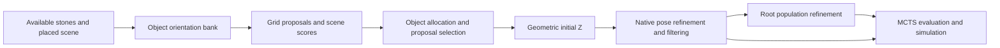

# Initial placement pose sampling for automated stone stacking

Implementation summary for a conference paper, inspected on **2026-10-06**.
Tabletop's scored XY sampling was aligned with excavator on **2026-10-07**.

This document describes the current working-tree implementation in
`stacking-apps`, with excavator as the primary platform and tabletop as a
comparison. Values below are the current repository defaults. A recorded
experiment may use a different profile, command-line overrides, or saved
configuration; its effective settings must be reported separately.

## 1. Purpose and algorithm structure

Initial placement poses provide starting points for the native placement
optimizer. The generator combines a finite orientation bank with scene-aware
XY proposals, computes a conservative starting height, and refines each pose
with DSF contact and equilibrium optimization. Accepted actions subsequently
enter MCTS evaluation and simulation.

The sampled variables are an object identity, a planar position, and an
orientation selected from a structured bank. Initial Z is computed from
geometry. At the root of the search tree, an additional population refinement
stage perturbs XY and yaw around promising initial poses.



The root refinement branch applies at the root; ordinary deeper-node expansion
uses the platform generator directly. Simulation-based stability and execution
feasibility are subsequent stages, so a selected initial pose is a hypothesis,
not a certified placement.

## 2. Notation and geometry

Let the current stacking state be $s$, with available objects
$\mathcal I(s)$ and placed objects $\mathcal J(s)$. For candidate object
$i$, an initial pose is

$$
T_i^0=(R_i^0,t_i^0),\qquad t_i^0=(x_i,y_i,z_i^0).
$$

The Python representation is
`[x, y, z, qx, qy, qz, qw]`, using scalar-last unit quaternions. Placement search
uses the stack frame; platform composition supplies the transform to the robot
world frame for motion planning.

Several geometries participate in initialization:

| Geometry | Role in initial pose generation |
|---|---|
| Convex component nodes and faces from `model_<id>.obj` | Orientation construction, height-map rendering, component-volume queries, and tabletop initial bounds |
| Global convex hull of the component nodes | Excavator PCA and orientation-dependent bottom kernels |
| Reconstructed `model_<id>_mesh.ply` vertices | Excavator initial-height bounding boxes, with component vertices as fallback |
| Smooth DSF components | Native contact queries and pose refinement |

The hulls used by proposal heuristics differ from both the reconstructed
surface and the smooth DSF envelope. In particular, a global hull can bridge
concavities between components.

Both platforms render a **128 × 128** top-surface height map from the placed
component meshes. The bounds are a square centered on the target XY origin,
with side length

$$
L=\max(W,\ell)+m,
$$

where $W$ and $\ell$ are target width and length, and $m$ is the
configured height-map margin. Both XY proposal grids have **32 × 32** samples
spanning these same bounds, including the endpoints. Their spacing is
$L/31$, followed by a target-region mask. Thus 32 × 32 denotes the complete
observation domain, not 32 × 32 valid anchors inside the target.

| Quantity | Excavator | Tabletop |
|---|---:|---:|
| Target width × length × height | 2 × 4 × 2.5 m | 0.08 × 0.17 × 0.15 m |
| Height-map margin parameter | 1 m | 0.02 m |
| Square observation span $L$ | 5 m | 0.19 m |
| XY proposal spacing $L/31$ | Approximately 0.1613 m | Approximately 0.00613 m |
| Target inward taper | 5° on all four sides | 10° on both length sides; 0° on width sides |

## 3. Excavator orientation hypotheses

The excavator profile sets `pose_from_scan: false`. Its base orientation is
constructed from the global hull vertices of the convex-component model.

For centered vertices $v_k-\bar v$, the implementation forms the covariance
matrix

$$
C=\frac{1}{N}\sum_{k=1}^{N}(v_k-\bar v)(v_k-\bar v)^\mathsf T.
$$

The eigenvector with the largest eigenvalue defines the longest principal
axis; the smallest defines the shortest. The longest axis becomes X and the
shortest becomes Z. Axis signs are resolved by making the largest-magnitude
coordinate positive, and cross products complete a right-handed basis. If
$P$ has these axes as columns, the canonical body-to-stack rotation is
$R_{\mathrm{PCA}}=P^\mathsf T$.

Initial rotations are constructed as

$$
R_i^0=R_z(\psi)R_x(\phi)R_{\mathrm{PCA}},
\quad
\phi\in\{0,\pi\},
\quad
\psi\in\{0,\tfrac{\pi}{2},\pi,\tfrac{3\pi}{2}\}.
$$

This yields up to eight distinct rotations per object. Numerically equivalent
rotation matrices are deduplicated by the scored sampler. These hypotheses
favor placing the stone on one of two opposite faces associated with its
shortest principal axis. PCA is a geometric heuristic; the orientations are
not established stable equilibria before native refinement.

With `pose_from_scan: true`, excavator instead uses the supplied inventory
orientation as its base and applies the configured yaw angles. That alternative
also enables a scan-relative orientation filter. It is not the current default.

## 4. Excavator XY anchors and support estimates

### 4.1 Target mask and floor footprint

XY anchors are drawn from the regular proposal grid. The initial target mask
uses the nominal target rectangle, inset in each direction by

$$
\delta_{xy}=0.6\,\frac{e_{xy}}{2},
$$

where $e_{xy}$ is the object's asset-local XY bounding-box extent. The
configured additional mask margin is zero. This inset permits controlled
overhang; it does not establish full containment of the rotated object.

For gap filling and frontier scoring, the excavator scorer uses an
axis-aligned rectangular footprint with half-extents
$0.9e_{xy}/2$. These coarse floor masks use asset-local extents. The separate
bottom-height support kernel is orientation dependent.

### 4.2 Orientation-dependent bottom kernel

For each rotation, the sampler rasterizes the lower surface of the global
convex hull onto a sparse set of grid offsets. Let $b_R(u)$ denote the
object's local bottom height at footprint offset $u$, and let
$h_s(a+u)$ be the scene height at XY anchor $a$ plus that offset.

The estimated vertical translation that clears the sampled scene is

$$
\widehat z(a,R)=\max_{u}\big[h_s(a+u)-b_R(u)\big].
$$

An offset is treated as supporting the object if

$$
\widehat z(a,R)+b_R(u)-h_s(a+u)\le\epsilon_c,
\qquad \epsilon_c=0.10\ \mathrm m.
$$

The support-likelihood score is the fraction of kernel offsets satisfying this
condition. The scorer also records the mean scene height over these contact
offsets. A kernel extending outside the height-map domain produces an invalid
support score and is omitted.

The term called candidate `height` in the excavator scorer is this mean contact
surface height. It differs from the translation estimate $\widehat z$, the
candidate's lowest point, and the later bounding-box initialization height.

## 5. Excavator proposal score and selection

### 5.1 Score terms

The excavator YAML keeps initial planar sampling settings together under
`planar` in [action_generation.yml](../apps/excavator/config/action_generation.yml):

| Configuration block | Terms | Consumer |
|---|---|---|
| `planar.score` | Seven named weights: `height`, `support_likelihood`, `open_area`, `fill_area`, `frontier`, `target_boundary`, `excavator_distance` | Excavator's `ScoredPlanarPoseSampler`, through `_scored_floor.score_xy_debug_map` |
| `planar.floor` | Coverage mode, fill ratio, grid size, bottom tolerance, layer limit, contact-cell minimum | `ActiveFloorPolicy` supplies layer geometry and filtering |
| `planar.floor_fill` | Legacy proposal-kernel controls | Private scored-floor helper; shared layer context overrides its layer estimate during normal composition |

`planar.score` is the only excavator proposal-weight source. The shared
`ActiveFloorPolicy` constructor has no score weights. Tabletop now uses the
same named `planar.score` block in its own profile. The old six-term weights
on `TabletopPlacementSafety` were removed with the obsolete deterministic
sampler after alignment.

Before consolidation, excavator had root-level `floor` and `scored_sampling`
blocks. Its six-entry `floor.score_weights` list was unused by the excavator
sampler; the seven named `scored_sampling.score` weights were effective.
The old list is removed, floor geometry moved to `planar.floor`, and the
contents of `scored_sampling` moved under `planar`. Obsolete YAML blocks are
rejected so that edits cannot silently target inactive weights. Effective
weights and sampling behavior are preserved. Saved planning contexts still
record runtime `floor_settings` and `sampling_settings` separately.

In the historical `excavator_plan8_gpu.stack` and `excavator_plan9_gpu.stack`,
the only recorded planning-context difference is the unused floor-weight
list: respectively $[-3,2,0,2,0,1.5]$ and $[-3,2,1,2,1,1.5]$.
Their active seven named weights are identical. Those files therefore do
not record an excavator proposal-score ablation.

Each retained anchor/orientation pair receives

$$
S=-3H+2Q+O+2F+G+1.5B+2D.
$$

| Term | Current definition | Intended geometric bias |
|---|---|---|
| $H$ | Mean contact height normalized over retained anchor/orientation candidates | Lower supporting surfaces |
| $Q$ | Fraction of bottom-kernel samples within the contact tolerance | Broader approximate support |
| $O$ | Unoccupied cells divided by cells in the coarse rectangular floor footprint | More open floor under the candidate |
| $F$ | Unoccupied footprint-cell count divided by the largest such count among retained anchors | Covering a larger unfilled area |
| $G$ | Fraction of footprint cells intersecting the dilated occupancy mask | Adjacency to the existing footprint |
| $B$ | Maximum absolute normalized XY coordinate relative to the height-dependent target bounds | Positions nearer a target boundary |
| $D$ | Distance to a reference point, divided by target XY diagonal and clipped to one | Greater distance from that reference |

The height normalization is

$$
H=\frac{h_c-h_{c,\min}}{\max(h_{c,\max}-h_{c,\min},10^{-6})}.
$$

For target boundary scoring, each side shrinks by
$z\tan\theta$, with $z$ measured from the target origin and clipped to
the nominal target height. The coordinate normalization returns zero for
anchors outside these height-dependent bounds. That condition removes the
boundary bonus; the scorer's initial valid mask is still the base-rectangle
mask.

With the current `excavator_xy: null`, the distance reference is **[0, 0]** in
the search frame. A positive distance weight rewards farther positions. The
paper should describe this direction accurately rather than calling the term
a preference for shorter robot travel. Likewise, boundary proximity rewards
edge proximity rather than a center-seeking preference.

On an empty active floor, open area defaults to one, fill and frontier terms
are zero, and the remaining terms drive selection. The score is a proposal
heuristic, distinct from both MCTS return and the native pose objective.

### 5.2 Diversity and Boltzmann draws

Within a candidate pool, weighted draws use

$$
p_j=\frac{\exp(S_j/\tau)}{\sum_{k\in\mathcal P}\exp(S_k/\tau)},
\qquad \tau=0.3,
$$

over the currently unselected members of that pool. Numerical evaluation
subtracts the maximum logit before exponentiation. The probability floor is
zero.

Selection proceeds through several pools:

1. Draw representatives from the upper, middle, and lower thirds of the
   candidate Y range, subject to the requested count.
2. Draw representatives from empty-gap subregions, processing larger gaps
   first. A subregion is identified by its connected empty component and its
   position relative to that component's center.
3. Add high-scoring candidates using an elite-count target of
   $\lceil0.25k\rceil$, where $k$ is the requested count. Earlier diversity
   selections can consume this budget.
4. Draw representatives from combinations of three height bands and four XY
   quadrants, ordered by the best score in each pool.
5. Fill remaining slots with weighted draws from unselected candidates.

The excavator profile uses no minimum-distance thinning between XY proposals.
Root population deduplication later applies its own thresholds.

An implementation detail is that gap representatives are not capped by the
number of selections already made. The sampler can therefore return more
than its nominal requested count. The action generator subsequently selects
only the allocated number. Consequently, the full proposal distribution is a
composition of diversity draws, score draws, and generator-level selection;
it is not a single global softmax over every candidate.

### 5.3 Allocation across objects

Each fresh generation call allocates requested attempts in round-robin order
across unplaced, non-banned objects, up to 32 allocations per object. When
lower-floor priority is inactive, available objects are shuffled and the
generator randomly selects from each object's sampled list. When lower-floor
priority is active and at least one object is placed, it takes a prefix of
each list. For small requests, it rotates the starting object across calls.

The sampler draws a fresh population on each call using persistent private
Python and NumPy random-number generators. Retry offsets do not advance a
fixed deterministic list as they did for the previous tabletop generator.
Both current platforms use this fresh-population allocation procedure.

## 6. Active-floor policy

Excavator's main composition shares one `ActiveFloorPolicy` between proposal
sampling and filtering. Its current settings are:

| Setting | Excavator | Tabletop |
|---|---:|---:|
| Occupancy representation | Projected union of convex-component footprints | Component-volume intersections with a bottom slab |
| Occupancy grid | 16 × 16 cell-center samples | 32 × 32 samples including endpoints |
| Floor completion fraction | 0.75 | 0.90 |
| Bottom-height tolerance | 0.20 m | 0.02 m |
| Maximum traversed layers | 8 | 8 |
| Minimum frontier contact cells | 1 | 1 |
| Strict action-build floor filter | Enabled | Disabled |

Starting at the target base, the policy collects stones whose bottom is within
the current layer tolerance. If their union covers the required fraction, it
advances the support height to the highest top among those stones and repeats
with remaining stones. The first insufficiently filled layer is active.

For either platform's `lower_floor_first` sampling, candidates whose estimated
contact height is at most active support height plus the platform's bottom
tolerance are selected before higher candidates: 0.20 m for excavator and
0.02 m for tabletop. The strict filter separately checks the bottom
height and connectivity of the **solved** pose. These checks act on different
quantities and should be described separately.

After a placed footprint exists, either platform's scored proposal construction
requires some open footprint area and at least one cell touching dilated
occupancy. Its U-shaped-pocket filter is disabled.

The search contains a conditional fallback: if ordinary root selection fails
with a strict floor filter present, it tries a new root under relaxed floor-fill
sampling/filtering. Native pose feasibility and subsequent physical evaluation
still apply. Thus the complete search policy permits an explicit floor-fill
fallback, rather than guaranteeing that every selected action satisfies the
strict lower-floor preference.

The current excavator retry limit allows an initial relaxed root pool and up
to three further retry pools, subject to the original deadline and pool
availability. Relaxation is conditional on a final-validation request and
available time.

The YAML also retains `planar.floor_fill.lower_floor_fill_ratio: 0.6`
for the private legacy helper. The normal excavator composition supplies the
shared active-floor context, whose operative completion threshold is
`planar.floor.fill_ratio: 0.75`.
These similarly named settings should not be conflated when reporting the
method.

## 7. Tabletop proposal strategy

### 7.1 Comparison of current XY sampling defaults

Both platforms enumerate a regular **32 × 32** anchor grid from a rendered
**128 × 128** scene height map. Neither platform starts by drawing continuous
uniform XY coordinates. Their initial grid proposals differ as follows:

| Step | Tabletop | Excavator |
|---|---|---|
| Sampler | `ScoredPlanarPoseSampler` | `ScoredPlanarPoseSampler` |
| Scene-map reduction | Block maxima, with a separate smoothed fallback map | Same |
| Default orientation bank | Scan-aligned orientation with retained tilt; two yaws, 0°/180° | PCA orientation; two rolls and four yaws, up to eight distinct rotations |
| Support geometry | Orientation-dependent global convex-hull bottom kernel | Same |
| Floor-filling geometry | Asset-local axis-aligned rectangular footprint on the active-floor grid | Same |
| Support contact tolerance | 0.02 m | 0.10 m |
| Active-floor occupancy | Bottom-slab volume intersections, 32 × 32; advance at 90% | Projected component footprints, 16 × 16; advance at 75% |
| Weighted score | $-3H+2Q+O+2F+G+1.5B+2D$ | Same |
| Boundary feature | Bounds tapered according to estimated contact height | Same |
| Selection | Seeded weighted draws, Y-region and gap representatives, elite candidates, height/quadrant representatives | Same |
| XY separation | No sampler distance thinning | Same |
| Repeated requests | New draws advance persistent private RNGs | Same |

Both compositions now use the same score definitions and selection code.
Their different geometry, orientation banks, physical tolerances, and floor
contexts still produce different candidate banks and rankings. Tabletop's
previous six-term sampler and its different feature definitions are recorded
in Section 7.3 for historical comparisons.

Tabletop's default `strict_floor_first: false` still uses scored proposals
and prefers its lower contact-height pool through `lower_floor_first`; it
omits the strict solved-pose floor filter. Excavator enables that strict filter.
The conditional relaxed root fallback is described in Section 6.

The shared strategy subsequently initializes Z and invokes native placement
optimization, which can move the initial XY coordinates.
Root population refinement can also create continuous XY perturbations.
The alignment changes tabletop proposal behavior; it does not demonstrate
improved physical placement or end-to-end search quality.

### 7.2 Current tabletop composition and configuration

Tabletop currently enables `pose_from_scan`. It finds the object's longest
local axis, transforms that axis with the measured orientation, and applies a
world-Z correction that aligns its projected heading with X modulo 180°. The
measured tilt is retained. The yaw bank then adds **0° and 180°**.

Both platforms inherit `StackingSearchApplication.build_action_generator`,
which constructs `ScoredPlanarPoseSampler` and
`ScoredPlacementActionGenerator`. Excavator overrides only its PLY-based
height initializer; tabletop retains `MeshHeightInitializer` with 0.015 m
clearance and 0.012 m padding.

Tabletop's [action_generation.yml](../apps/tabletop/config/action_generation.yml)
explicitly resolves temperature 0.3, elite fraction 0.25, the same seven
dimensionless weights as excavator, and its own 0.02 m contact tolerance.
`excavator_distance` retains the shared scorer's historical field name: it
measures distance from the configured reference, with a target-relative
fallback when `excavator_xy` is null. It does not use excavator robot geometry
in a tabletop run.

`TabletopPlacementSafety` continues to supply its 32 × 32 bottom-slab floor
context, 90% completion threshold, and 0.02 m bottom tolerance. Initial scan
orientation, solved-orientation filtering, target-containment checks, and
solver acceptance limits remain platform-owned.

Every effective sampler setting is recorded as
`action_generation_profile.sampling_settings` in tabletop planning contexts.
Together with the changed minimum-separation value, this makes the existing
resume validation reject contexts recorded with the previous sampler.
Historical artifacts remain readable; this change does not rewrite them.

### 7.3 Historical tabletop sampler before 2026-10-07

The rest of this section describes the former `HeightMapPlanarPoseSampler`
and the tabletop composition used before alignment. That implementation has
been removed from the live checkout. Its equations and
selection procedure are historical, not the current tabletop defaults.

The sampler enumerates valid grid anchors for each orientation. With the
current target inset, the center bounds use 0.6 times the asset-local
half-extent. Full rotated bounding-box fitting is used only when that inset
option is absent.

Both root and deeper priorities are configured as `lower_floor_first`.
Tabletop therefore constructs orientation-dependent footprint kernels from
the union of component volumes. It computes support height, support
likelihood, unfilled area, frontier, and target-boundary features, with weights

$$
S_{\mathrm{tabletop}}=-3H+2Q+O+3F+G+1.5B.
$$

It deterministically sorts candidates by descending score and interleaves
queues associated with different gap subregions and orientations. It then
applies a **3 mm** minimum XY separation within each orientation. With
lower-floor priority disabled, it instead sorts by increasing scene height.

The common generator interleaves proposals across objects and supports
resuming from an attempt offset. This differs from excavator's fresh random
draws. With lower-floor priority enabled, tabletop's `planar_score` records
the complete six-term floor score and determines proposal order. The root
ranking bonus instead reads the separate `height_map_score_normalized`
diagnostic, computed from footprint support height. With floor ranking
disabled, `planar_score` is the negative raw anchor height.

The scan-relative solved-orientation filter uses a 45° bound on the XY
components of the relative rotation vector and rejects upside-down changes.
It admits a documented exception for solved poses that fill the active lower
layer. These are rotation-vector tests, not separate Euler roll/pitch limits.

### 7.4 Removal of unused sampling code

After alignment, neither platform used the deterministic height-map sampler,
its `FloorProposalRanker`, or the tabletop legacy `ActionBuilder` adapter.
Those implementations and their obsolete exports, factories, and six-term
weights have been removed. Tests specific to those removed implementations
were removed; measured-orientation coverage now exercises the scored sampler.

Two uncalled private helpers, `active_layer_fill_metrics` and
`target_structure_xy_overlap`, and an unused smoothing import were also
removed. The active `ActiveFloorPolicy` and `TargetXYOverlapFilter` continue
to implement those checks. The unconsumed `lower_floor_fill_reject_stacked`
YAML key and its legacy constants were removed from both profiles.

Before/after verification compared **480 arrays** covering both platforms,
both orientation modes, empty and placed scenes, normal and relaxed scoring,
seeded draws, mutation-score lookup, and generation retries. They matched
bit-for-bit. Removing the ignored YAML key changes serialized settings, so
the existing strict saved-context comparison can reject an earlier run even
though the effective proposal behavior is unchanged.

The current seven-term score, floor geometry, standalone scored-sampler floor
context, and conditional root fallback remain active. In particular, the
`u_shape_footprint_scale` and `u_shape_min_frontier_contact_cells` settings
still control rectangular footprints and connectivity even with
`u_shape_filter: false`; they are not unused parameters.

## 8. Initial vertical translation

After selecting XY and orientation, the initializer temporarily sets
translation Z to zero, transforms the chosen object's geometry, and computes
its bottom height $b_i$ and XY bounding box. For existing placed objects,
it computes transformed bounding boxes at their current poses.

Let $\mathcal S(a,R)$ be placed objects whose padded XY bounds overlap the
candidate. The reference support height is

$$
h_{\mathrm{ref}}=\max\left(z_{\mathrm{base}},
\max_{j\in\mathcal S(a,R)}z_j^{\max}\right),
$$

and the initial translation is

$$
z_i^0=h_{\mathrm{ref}}-b_i+c.
$$

The clearance $c$ is 0.15 m for excavator and 0.015 m for tabletop. This
places the candidate above the highest potential support detected by the
bounds heuristic. It can overestimate support under a concavity or a broad
bounding box; it does not establish an actual contact location.

Excavator uses PLY vertices when available. Its 0.12 m padding expands both
footprints, so the overlap inequalities have an effective 0.24 m allowance
per axis. Tabletop uses component vertices and its overlap inequalities use a
single 0.012 m allowance. The two padding parameters therefore have different
operational meanings despite having similar names.

The bottom-kernel height estimate used in scoring is not substituted directly
into this initialization formula. Every fresh proposal and root mutation goes
through the initializer before pose optimization.

## 9. Native refinement and action-build acceptance

The initial pose is supplied to native DSF pose generation. Both current
platform profiles use four continuation stages at
$t\in\{0,1/3,2/3,1\}$, with platform-specific scheduled objective weights.
The refined pose can change translation and rotation beyond the discrete
initial orientation bank.

Action construction applies the following current checks:

| Check | Excavator | Tabletop |
|---|---|---|
| Invalid native result | Rejected | Rejected |
| Solver convergence flag | Not required by the generic filter | Required by default |
| Gap residual | $c_{\mathrm{gap}}\le0.005$ | $c_{\mathrm{gap}}\le0.003$ |
| Normalized equilibrium residual | $c_{\mathrm{feq}}<1$ | $c_{\mathrm{feq}}\le1$ |
| Target gate | Solved object's XY AABB overlaps nominal target rectangle | Estimated volumetric containment at least 0.5 |
| Strict floor filter | Enabled, with the conditional search fallback | Disabled |
| Scan-relative orientation filter | Disabled in current PCA mode | Enabled |

The native adapter normalizes the maximum L1 net-wrench norm by the maximum
object mass in the inventory. The gap value is the native residual, not a
claim that every geometric gap equals this threshold. Convergence status and
physical validity are separate checks; CUDA can still reject unusable native
results even when the generic convergence requirement is disabled.

The target gate is applied after native refinement, as are these floor and
orientation filters. Dynamic settling, noisy-placement trials, and final
motion planning provide additional evaluation beyond this initial-pose module.

## 10. Root population refinement

The implementation class is named `CEMRootActionGenerator`. Its operation is
best described in a methods section as **elite-guided population refinement
with fixed Gaussian XY/yaw mutations and fresh proposals**. It does not fit an
adaptive Gaussian mean or covariance to the elites.

It first requests a fresh population, removes duplicates, and ranks accepted
native-refined candidates. On each subsequent round, it limits parent
contributions per object, selects an elite list, and chooses mutation parents
uniformly from that list. It perturbs the parent's saved **initial** pose:

$$
a'=a+\eta_{xy},\quad
\eta_{xy}\sim\mathcal N(0,\sigma_{xy}^2I_2),
\qquad
R'=R_z(\eta_\psi)R,\quad
\eta_\psi\sim\mathcal N(0,\sigma_\psi^2).
$$

It recomputes initial Z and reruns native pose generation and filters. The
same-object identity is retained. Mutation introduces continuous XY and yaw
variation around the structured seeds; it does not independently sample Z,
roll, or pitch. Gaussian mutations are not clamped to the original anchor
mask before solving; solved-pose filters provide the subsequent gate.

Newly built mutations and fresh proposals are combined with retained
candidates, deduplicated, and ranked. If the fresh quota cannot be filled and
parents exist, additional parent mutations can replace missing fresh attempts.
Population sizes are upper limits because proposal availability, rejection,
deadlines, and per-object caps can reduce the accepted pool.

For the standard composition, the root ranking score is

$$
J_{\mathrm{root}}=
-w_s\min\left(\frac{\max(c_{\mathrm{feq}},0)}{\tau_e},1\right)
+w_c C_i+w_h\widetilde S_i,
$$

where $C_i$ is estimated object containment, $\tau_e=1$, and
$\widetilde S_i$ is the normalized proposal score bonus. The weights
$(w_s,w_c,w_h)$ are **(2, 2, 1)** for excavator and **(0.5, 2, 1)** for
tabletop. This ranking occurs before simulation and differs from the complete
transition reward. Both platforms now supply the normalized scored-map value.

For a fresh candidate on either platform, the normalized bonus is

$$
\widetilde S_i=
\operatorname{clip}\left(
\frac{S_i-S_{\min}}{\max(S_{\max}-S_{\min},10^{-12})},0,1\right),
$$

where the extrema are over that object's retained anchor/orientation pairs.
Before alignment, tabletop instead normalized footprint support height
against extrema of its nearest-neighbor resampled scene map. A flat map then
gave zero bonus; the current shared scorer can distinguish boundary and
reference-distance features even when the scene height is constant.

For a mutation on either platform that does not match an already sampled pose, the
proposal bonus falls back to the nearest XY cell of the object's cached score
map. That map stores the best score among the discrete orientations at each
cell; it does not recompute a bottom kernel for the newly perturbed yaw.
Before alignment, tabletop mutations queried raw height at a nearest cell
of the original **128 × 128** map, while fresh proposals used footprint
support height on the resampled **32 × 32** map. That differing feature and
normalization path is no longer used by the active tabletop composition.
The standard root ranking reads explicit `height_map_score_normalized`
diagnostics, which now carry normalized scored-map values on both platforms.
Native refinement still evaluates the actual mutated pose. These bonus
lookups should be described as approximate guidance.

| Root parameter | Excavator `mcts_cuda.yml` | Tabletop `mcts.yml` |
|---|---:|---:|
| Population | 96 | 96 |
| Elite-list limit | 32 | 24 |
| Total rounds, including initial population | 3 | 3 |
| Final retained-candidate limit | 32 | 12 |
| XY mutation standard deviation | 0.20 m | 0.01 m |
| Yaw mutation standard deviation | 5° | 5° |
| Fresh fraction in later rounds | 0.50 | 0.30 |
| XY duplicate threshold | 0.03 m | 0.003 m |
| Angular duplicate threshold | 5° | 5° |
| Per-object cap for elites and final retention | 2 | 8 |
| Proposal bonus weight | 1 | 1 |
| Seed | 0 | 0 |

Duplicate detection compares object identity, initial XY distance, and the
**full quaternion angular distance**. Although the configuration calls the
last value `duplicate_yaw_threshold_degrees`, the implementation does not
compare yaw alone. It also does not compare initial Z.

Three configured rounds mean one initial population plus two mutation/fresh
rounds. In normal parent-supported rounds, the fresh quota is 48 for excavator
and 29 for tabletop, with the remainder allocated to mutation. Root retries
increment the mutation seed and exclude earlier root proposals.

## 11. CPU/CUDA placement and scene-identification initialization

Grid construction, orientation generation, score evaluation, and root mutation
are Python-side operations. Excavator's selected CUDA profile batches the
native pose-generation and simulation work. It does not define a different
initial orientation bank or XY proposal distribution. Numerical acceptance,
runtime, and deadline effects can still alter the resulting search.

The user's open native files refer to separate operations:

- `src/sceneid/evaluation.cpp` evaluates scan agreement and screens DSF gaps
  for supplied poses.
- `src/cuda/queries.cu` evaluates support, contact, and related geometric
  queries used by native computation.

`SceneIdentifier::solve()` initializes from the current poses in its canonical
scene and sets local pose increments to zero. If the starting scene penetrates,
it first attempts physical restoration and uses the restored poses as the
chart seed. It then alternates scan fitting and physical refinement. This is
local scene estimation from a supplied scene, rather than a global bank of
placement hypotheses.

Upstream perception has its own initial registration hypotheses. Excavator
field registration constructs 64 Euler-angle combinations from
$\{0,90,180,270\}^3$, some of which represent equivalent rotations;
in-hand registration constructs four X-axis rotations relative to the supplied
pose. Tabletop's field matcher uses a 24-orientation bank, centers each
hypothesis against the observation, and brings its first-percentile height to
the table plane. Providing an explicit initial transform bypasses that bank.
These hypotheses estimate observed object poses and should be described in a
perception subsection rather than counted as placement seeds.

## 12. Paper-ready methods draft

The following passage describes the current excavator implementation. Replace
the parameter values if the experiments used different effective profiles.

> We generate initial placement hypotheses by combining a finite set of
> geometry-derived orientations with scene-aware planar anchors. For each
> available stone, principal-component analysis aligns its longest and shortest
> axes with the horizontal X and vertical Z axes, respectively. Two opposite
> roll variants and four cardinal yaw angles provide up to eight distinct
> initial orientations. We evaluate these orientations over a regular planar
> grid restricted by a target-region mask. Orientation-dependent lower-surface
> kernels estimate contact coverage against the current stack height map.
> Candidate scores combine contact height, approximate support coverage,
> unfilled floor area, adjacency to existing stones, target-boundary proximity,
> and distance from a reference point. A combination of regional
> representatives, high-scoring candidates, and Boltzmann draws preserves
> spatial diversity while favoring promising hypotheses.

> We initialize vertical translation above the highest placed-object bounding
> box whose padded planar footprint overlaps the candidate. Each hypothesis is
> then refined by a native DSF placement optimizer and screened using
> equilibrium, gap, target-overlap, and active-floor checks. At the root of the
> placement search, an elite-guided population refinement stage adds fixed-scale
> Gaussian perturbations to initial XY coordinates and yaw while retaining
> fresh grid proposals. Heights and refined placements are recomputed for every
> mutation. Per-object caps and pose deduplication preserve diversity across
> stones. Accepted placements are subsequently evaluated by simulation within
> MCTS. The excavator policy prioritizes filling the active lower layer and
> permits a conditional relaxation of floor-fill restrictions when ordinary
> root selection fails.

## 13. Reproducibility and interpretation

Record the actual experiment configuration, input scene, asset hashes,
random-number seeds, backend versions, and effective time budget. A fixed
seed makes the random draws reproducible for the same call sequence; changes
in retries, object order, rejection, or deadlines can change that sequence.

The current geometry and sampling impose the following limits on claims:

1. The orientation bank samples selected principal-axis faces or scan-relative
   orientations. It does not exhaustively sample SO(3), and native refinement
   does not establish global optimality.
2. Support likelihood is a geometric contact-coverage heuristic, not a
   calibrated stability probability or force-closure certificate.
3. The height map stores only the highest surface at each XY location.
   Undercuts, cavities, and disconnected vertical surfaces are simplified.
4. Different stages use global hulls, component unions, PLY bounds, and smooth
   DSFs. Their approximation errors differ and can change proposal ranking
   and refinement behavior.
5. Score normalization, diversity pools, and object allocation make sampling
   state dependent. The Boltzmann formula applies within each draw's pool.
6. Boundary and distance weights currently favor target edges and greater
   reference distance. Their utility should be supported by the paper's
   experiments rather than asserted from the term names.
7. Root refinement uses fixed mutation scales. Describing it as fitting a
   Gaussian distribution to elites would misrepresent the implementation.
8. Strict floor filtering includes an explicit relaxation path. The paper
   should report whether that fallback occurred in the evaluated runs.

Potential ablations include orientation-bank size, contact-kernel scoring,
regional diversity, Boltzmann temperature, floor priority, root mutations,
fresh fraction, and per-object caps. These are suggested experiments; this
document contains proposal-score sensitivity measurements below, but no new
native-placement, simulation, or end-to-end search-quality measurements.

### 13.1 Measured excavator proposal-score sensitivity

The diagnostic [analyze_initial_pose_scores.py](../tests/analyze_initial_pose_scores.py)
was run with the excavator configuration before its YAML layout consolidation,
all 49 configured object assets,
and the nine recorded placed-object poses in
[excavator-cuda-mcts.json](benchmarks/excavator-cuda-mcts.json). It renders
five states containing 0, 1, 3, 6, and 9 of those stones, retaining their
final recorded poses. These subsets are diagnostic scenes, rather than a
replay of historical stacking states. All configured masks, support-kernel
validity checks, connectivity gates, and lower-floor priority remain active.

The run checked **274,096** retained anchor/orientation pairs. It reconstructs
each candidate's seven weighted terms and verifies their sum bit-for-bit
against the scorer. Comparison scores are then rounded to 12 decimal places
to suppress numerical tie changes when a constant term is removed. Production
scoring does not apply that rounding. The
[full report](benchmarks/initial-pose-score-sensitivity.json) records source
and asset hashes, per-object results, and matched sampling seeds 0 through 9.
No native solve, root population refinement, or physical simulation is run.
The report retains the hashes from that run. Consolidation changes configuration
and composition hashes, but preserves the effective weights. A separate
before/after comparison verified bit-for-bit equality of 89 score-map,
seeded-selection, and shared-floor arrays for empty and placed fixture scenes.

To measure discrimination, use the standard deviation of each **weighted**
term across candidates, then average equally across available objects. A
constant contribution has zero discrimination even if its mean is large.
This statistic measures score variation; correlations between terms prevent
interpreting it as a percentage of total ranking influence.

The table uses the first nonempty sampling-priority pool for each object:
lower-floor candidates when available, otherwise all candidates. If that pool
has fewer than 32 entries, actual sampling can also draw from the higher pool.

| Placed stones | $-3H$ | $2Q$ | $O$ | $2F$ | $G$ | $1.5B$ | $2D$ | Largest variation |
|---|---:|---:|---:|---:|---:|---:|---:|---|
| 0 | 0.000 | 0.186 | 0.000 | 0.000 | 0.000 | 0.352 | 0.204 | Boundary |
| 1 | 0.112 | 0.248 | 0.004 | 0.223 | 0.089 | 0.272 | 0.076 | Boundary |
| 3 | 0.062 | 0.210 | 0.009 | 0.221 | 0.055 | 0.345 | 0.066 | Boundary |
| 6 | 0.171 | 0.327 | 0.009 | 0.214 | 0.093 | 0.109 | 0.044 | Support |
| 9 | 0.865 | 0.218 | 0.207 | 0.437 | 0.101 | 0.452 | 0.206 | Height |

Across the complete candidate banks, height has the largest average weighted
variation in all four occupied states. Lower-floor priority removes much of
that variation before the first weighted draw. In the nine-stone state, none
of the 40 remaining objects has a candidate whose estimated contact height
is within 0.20 m of the active floor, so sampling uses the higher pool. Active
floor occupancy is still only 0.566. This is a proposal-geometry limitation
that changing score weights alone cannot resolve.

Only $H$ and $Q$ directly evaluate the scene height map. $O$, $F$, and $G$
use active-floor occupancy, while $B$ and $D$ add geometric position
preferences. The seven terms therefore represent three different sources of
guidance.

The removal comparisons keep the candidate bank fixed. Rank correlation is
Spearman correlation within the first nonempty priority pool. Top-32 overlap
uses only objects with more than 32 candidates in that pool, so retaining
every member of a small pool does not inflate the result. The report also
compares populations drawn by the sampler's regional and Boltzmann selection;
matched-seed population overlap describes sampling sensitivity rather than
physical quality or an unchanged probability distribution.

The preliminary simplification order is:

1. **Remove or merge open area $O$ first.** In occupied-floor scoring, $O$
   and $F$ share the numerator $n_U$, with different denominators. When
   footprint sample count $n_A$ is
   constant, they are proportional. Their mean per-object correlation over
   the complete occupied candidate banks is 0.89–0.96. In the 1-, 3-, and
   6-stone priority pools, $O$ is nearly constant; removing it leaves ranking
   correlation above 0.998. At nine stones it still changes some preferred
   candidates, so merging also requires checking the remaining fill weight.
2. **Ablate reference distance $D$ next.** The current reference is the target
   origin, so this is an additional edge preference without an independently
   specified reach or robot-distance objective. It overlaps with $B$, while
   using a different distance geometry. Its influence is substantial on an
   empty floor, where $H=0$, $O=1$, and $F=G=0$. Removing it will change the
   preferred first-placement locations.
3. **Ablate the frontier bonus $G$ after that.** The connectivity gate already
   requires at least one neighboring footprint cell. Removing the score
   bonus preserves that gate but removes the preference for broader
   adjacency. This is a distinct preference, so it requires a physical
   quality comparison before removal.
4. **Retain $H$, $Q$, and one fill measure initially.** They distinguish
   supporting height, approximate contact coverage, and target-floor filling.
   Retain $B$ during the first simplification because it is the strongest
   spatial preference in the empty and early priority pools. Its removal is
   a separate experiment on the placement strategy.

A concrete four-term experimental score is

$$
S_4=-3H+2Q+2F+1.5B.
$$

The more aggressive three-term comparison is $S_3=-3H+2Q+2F$. The mean
top-32 overlap with the current seven-term score is:

| Placed stones | Objects with more than 32 priority candidates | $S_4$ overlap | $S_3$ overlap |
|---|---:|---:|---:|
| 0 | 49 | 33.7% | 12.4% |
| 1 | 29 | 94.6% | 75.6% |
| 3 | 28 | 93.4% | 73.0% |
| 6 | 19 | 98.5% | 97.7% |
| 9 | 40 | 77.5% | 56.3% |

Removing $D$ alone retains 33.7% of the empty-floor top 32, illustrating its
effect on first-placement positions. On an empty floor, $S_3$ has no XY
score preference, so regional draws determine spatial coverage. Gap diversity
also applies once occupied-floor gaps exist. These are diagnostic candidates,
not changed repository defaults. Full placement comparisons should record accepted
native solves, root floor-fill fallback frequency, target coverage, failed
settling/noisy-placement trials, and search outcome under the same backend,
input states, seeds, and time budgets. Removing a proposal term can also
change the normalized root bonus described in Section 10.

Reproduce the sensitivity report with the project Python and model assets:

```sh
OPENBLAS_NUM_THREADS=1 OMP_NUM_THREADS=1 \
  python tests/analyze_initial_pose_scores.py \
  --output docs/benchmarks/initial-pose-score-sensitivity.json
```

## 14. Implementation references

Links are relative to this document so they remain usable from the repository.
The native references assume the sibling `stacking-core` checkout.

| Component | Source and relevant symbol |
|---|---|
| Excavator composition | [composition.py](../apps/excavator/src/stacking_excavator/composition.py): `build_orientation_provider`, `build_action_generator`, `build_floor_policy` |
| Tabletop composition | [composition.py](../apps/tabletop/src/stacking_tabletop/composition.py): `build_orientation_provider`, `build_floor_policy` |
| Shared search composition | [search.py](../packages/stacking-common/src/stacking_common/workflows/search.py): `build_mcts`, `_build_state_evaluators`, `build_action_generator` |
| Orientation bank | [orientation.py](../packages/stacking-common/src/stacking_common/actions/orientation.py): `canonical_principal_axis_rotation`, `PrincipalAxisOrientationProvider`, `ScanAlignedOrientationProvider` |
| Excavator sampler and allocation | [scored.py](../packages/stacking-common/src/stacking_common/actions/scored.py): `ScoredPlanarPoseSampler`, `ScoredPlacementActionGenerator` |
| Excavator scoring and draws | [_scored_floor.py](../packages/stacking-common/src/stacking_common/actions/_scored_floor.py): `score_xy_debug_map`, `target_anchor_bounds`, `sample_scored_candidates` |
| Bottom kernels | [_support_maps.py](../packages/stacking-common/src/stacking_common/actions/_support_maps.py): `bottom_height_kernel`, `support_likelihood_maps_by_kernel` |
| Shared current sampler | [scored.py](../packages/stacking-common/src/stacking_common/actions/scored.py): `ScoredPlanarPoseSampler`, `ScoredPlacementActionGenerator`; [search.py](../packages/stacking-common/src/stacking_common/workflows/search.py): `build_action_generator` |
| Historical tabletop sampler | Removed; equations and selection procedure are documented in Section 7.3 |
| Floor geometry | [floor.py](../packages/stacking-common/src/stacking_common/actions/floor.py): `ActiveFloorPolicy` |
| Tabletop floor values | [safety.py](../apps/tabletop/src/stacking_tabletop/planning/safety.py): `TabletopPlacementSafety` |
| Excavator height | [ply_height.py](../packages/stacking-common/src/stacking_common/actions/ply_height.py): `PlyHeightInitializer` |
| Tabletop height | [initialization.py](../packages/stacking-common/src/stacking_common/actions/initialization.py): `MeshHeightInitializer` |
| Build pipeline | [generator.py](../packages/stacking-common/src/stacking_common/actions/generator.py): `PlacementActionGenerator` |
| Pose refinement | [core_solver.py](../packages/stacking-common/src/stacking_common/actions/core_solver.py): `CorePlacementPoseSolver` |
| CUDA refinement | [cuda_solver.py](../packages/stacking-common/src/stacking_common/actions/cuda_solver.py): `CudaPlacementPoseSolver` |
| Acceptance filters | [filtering.py](../packages/stacking-common/src/stacking_common/actions/filtering.py): `PosegenFeasibilityFilter`, `ScanOrientationFilter`, `TargetContainmentFilter` |
| Root population | [cem.py](../packages/stacking-common/src/stacking_common/actions/cem.py): `CEMRootActionGenerator`, `_duplicate` |
| Root prior score | [policies.py](../packages/stacking-common/src/stacking_common/search/policies.py): `PlacementPriorScorer` |
| Floor-fill fallback | [search.py](../packages/stacking-common/src/stacking_common/search/mcts/search.py): `_run_floor_fill_fallback` |
| Height-map domain | [heightmap.py](../packages/stacking-common/src/stacking_common/visualization/heightmap.py): `HeightMapRenderer` |
| Excavator parameters | [action_generation.yml](../apps/excavator/config/action_generation.yml), [environment.yml](../apps/excavator/config/environment.yml), [inventory.yml](../apps/excavator/config/inventory.yml), [mcts_cuda.yml](../apps/excavator/config/mcts_cuda.yml), [posegen.yml](../apps/excavator/config/solvers/posegen.yml) |
| Tabletop parameters | [action_generation.yml](../apps/tabletop/config/action_generation.yml), [environment.yml](../apps/tabletop/config/environment.yml), [inventory.yml](../apps/tabletop/config/inventory.yml), [mcts.yml](../apps/tabletop/config/mcts.yml), [posegen.yml](../apps/tabletop/config/solvers/posegen.yml) |
| Excavator registration seeds | [pipeline.py](../apps/excavator/src/stacking_excavator/perception/pipeline.py): `orientation_seeds` |
| Tabletop registration seeds | [assignment.py](../apps/tabletop/src/stacking_tabletop/perception/assignment.py): `ORIENTATION_BANK`, `initial_table_transform` |
| Native scene-ID initialization | [consensus.cpp](../../stacking-core/src/sceneid/consensus.cpp): `SceneIdentifier::solve`; [scan.cpp](../../stacking-core/src/sceneid/scan.cpp): `validate_and_resolve_poses` |
| Native scene-ID evaluation | [evaluation.cpp](../../stacking-core/src/sceneid/evaluation.cpp): `evaluate_sceneid`, `screen_sceneid_gaps` |
| CUDA geometry queries | [queries.cu](../../stacking-core/src/cuda/queries.cu) |

Relevant existing test coverage includes
[test_excavator_action_parity.py](../tests/test_excavator_action_parity.py),
[test_floor_score_maps.py](../tests/test_floor_score_maps.py),
[test_action_generation.py](../tests/test_action_generation.py),
[test_excavator_floor_first.py](../tests/test_excavator_floor_first.py),
[test_tabletop_scored_sampling.py](../tests/test_tabletop_scored_sampling.py),
[test_tabletop_scan_orientation.py](../tests/test_tabletop_scan_orientation.py),
and [test_cuda_placement.py](../tests/test_cuda_placement.py). These files cover
seeded sampling parity, orientation construction, support footprints, height
initialization, root refinement, floor fallback, and batched refinement. They
are source references; the score diagnostic in Section 13.1 does not execute
these tests or run native-placement experiments.

## 15. Source snapshot

The HEADs and working-tree description below record the **original inspection
snapshot**. They are historical provenance, not the live checkout state.

- `stacking-apps` base HEAD: `3c2d3328e5b8552a21666434d67ea54b3813cd68`.
- `stacking-core` base HEAD: `aee2d5bb0269d8f160ec442230725cf5d7e415df`.

Both checkouts contained working-tree changes at that inspection. The excavator
action, inventory, and CUDA MCTS profiles and the common MCTS search file
had local changes; the native scene-identification sources were untracked
in the inspected core checkout. The HEAD identifiers alone therefore do
not specify the implementation summarized here. The following SHA-256
manifest identifies the referenced implementation and configuration files
as read for this document. Store the source and effective experiment
profiles with the paper artifacts to preserve reproducibility.

The score equations were expanded and checked on 2026-10-06. The subsequent
configuration consolidation changed the YAML layout and floor-policy interface
without changing the score equations or effective weights. The manifest
retains the original implementation and native source hashes; the native
scene-identification subsection describes that original snapshot.
The 2026-10-07 tabletop alignment subsequently changes its effective scoring
and selection strategy as described in Section 7.2; its earlier equations
are retained in Section 7.3. These changes are not represented by the original
manifest below.

```text
613f6f5753aab0fa42fb0ff55541c178438e16803141d918b32c4e2879072540  stacking-apps/apps/excavator/config/action_generation.yml
78fda3822f4f2fea563d8d084b83a4be59b0c54daa358af668e93aa13550d14d  stacking-apps/apps/excavator/config/environment.yml
c217ef2b227d131a5c5e0194b8548a057dced07892251141e69a9da616f64092  stacking-apps/apps/excavator/config/inventory.yml
6973a22ac546247f186b1f27a9e1161615e13b3c6ecb0bc5c075286ac27f4da6  stacking-apps/apps/excavator/config/mcts_cuda.yml
f419b1c2dfd778b9b129db0700c54636cd1d0175660048d3e6be947240db1624  stacking-apps/apps/excavator/config/solvers/posegen.yml
485735e23e4f69e77f9cbdf342681f4ca17d6d524868f62b7c4062443e3e2b42  stacking-apps/apps/excavator/src/stacking_excavator/composition.py
0a83664633a1fbcc0e52f76020e49c6bd7ed32988ed9c0da1c771611655c6b04  stacking-apps/apps/excavator/src/stacking_excavator/perception/pipeline.py
3d700daa5091f8da190cc660226659178059f589c391919617ba0e400cad96c0  stacking-apps/apps/tabletop/config/action_generation.yml
3f0e1cc58215e8e7699431551a567e7d607d0d629329173c4c8d0b880065a95f  stacking-apps/apps/tabletop/config/environment.yml
e2ccec0219b790e9422835ed650e0122dac2ada7c39747c9cf293bd0f4a0015e  stacking-apps/apps/tabletop/config/inventory.yml
10fface4e89c86dd23dbe725121b56cccfd417580927647f90eeae9de1ed15d5  stacking-apps/apps/tabletop/config/mcts.yml
3bb31fe1c327981e965d2dd135230b9cbef5575f7730305eba79272d51e4b86f  stacking-apps/apps/tabletop/config/solvers/posegen.yml
832aed442535ef56b79aa31e5faeda855141ceec4fc1cad5f6da151e6edb9b7d  stacking-apps/apps/tabletop/src/stacking_tabletop/composition.py
aaebbe2d47786fb9c86b43953a048cf58247fb6db76206aa4807c852c1e71a52  stacking-apps/apps/tabletop/src/stacking_tabletop/perception/assignment.py
1c9efdb2bcd74ca5e96543d64bf17538016b0ee8cbba145fdcda88a8764aa36f  stacking-apps/apps/tabletop/src/stacking_tabletop/planning/safety.py
29036fa58d9ae806044822bff579ef2ced2399f56558f43e193db5346983fe03  stacking-apps/packages/stacking-common/src/stacking_common/actions/_scored_floor.py
7261f73b1aaa563c7cfe85c8cac985a560ce1658fc0baf92d80e3eb785d2e566  stacking-apps/packages/stacking-common/src/stacking_common/actions/_support_maps.py
01c4d933714fa1f947b9351926af9f6357a136324218b3e3d18916f85e3adbf6  stacking-apps/packages/stacking-common/src/stacking_common/actions/cem.py
06f9f0eefec117ea9c1aa7120a524c240533d1dce3ba6184678462c3664d9de8  stacking-apps/packages/stacking-common/src/stacking_common/actions/core_solver.py
2b9274f9eff920db8dd9b1e9226fbf6e2f4fc40c4a369b931589ad65622d6b0a  stacking-apps/packages/stacking-common/src/stacking_common/actions/cuda_solver.py
483a995679d35d7f67bb8858617c006b4fa5bbc968cb9de46c0e84a407292970  stacking-apps/packages/stacking-common/src/stacking_common/actions/filtering.py
1b46dd34e214f462fd3236458ca927c47608c1d9f880489ca076c6587c07b7c4  stacking-apps/packages/stacking-common/src/stacking_common/actions/floor.py
c2f7f9727921163669e5cd09ce06b84fd1d6e76a5ea37257277280a3cd594a46  stacking-apps/packages/stacking-common/src/stacking_common/actions/generator.py
ff2b9c2f2838464ab9307263ba008df3631e4551d9e0d264e099b1f3da4ba376  stacking-apps/packages/stacking-common/src/stacking_common/actions/initialization.py
51a4d4012b4b96da31ef69787c0af11253e70f93659602c1f7c39e4e5d88c3a6  stacking-apps/packages/stacking-common/src/stacking_common/actions/orientation.py
ccad336807408104cabe11ae622092426df9b94f8312a670d2039d8be5f6cd61  stacking-apps/packages/stacking-common/src/stacking_common/actions/planar.py
c541358b3b63a591af4d8c5b7563178079fd0f68e6ce2ecbbb5fa6103be5af58  stacking-apps/packages/stacking-common/src/stacking_common/actions/ply_height.py
376a5235a32fd8aba012a955dbacdf7f01c296048e635ba2cf015a94f9294acd  stacking-apps/packages/stacking-common/src/stacking_common/actions/scored.py
ca4482b8b39828dc291792a15b621197ab8ac0f53a594076439a46c047219d57  stacking-apps/packages/stacking-common/src/stacking_common/search/mcts/search.py
a8b0947351191f53b0450728e4089d2447f6955c430fa92dc6411f82fa73c5ba  stacking-apps/packages/stacking-common/src/stacking_common/search/policies.py
85df6ff33847120d618d3763db6993ee1bb69d2febd3311af08f1837088f27f5  stacking-apps/packages/stacking-common/src/stacking_common/visualization/heightmap.py
ae8c0367b51ab31735f74900a8ee77e5c9ff3cb786bbf2e9db3de0c9216a44a9  stacking-apps/packages/stacking-common/src/stacking_common/workflows/search.py
e75dcfb08e1614b87324e918bc59146d8f3c64acb4f083a8f8e6757fa9f35abe  stacking-core/src/cuda/queries.cu
6b3c0b6a1478ea5741ea12d07c7da7b616f5621b3c4f737d5dde89882f2b181f  stacking-core/src/sceneid/consensus.cpp
d5ec9e1b8d1afa789bf112e90938d6967b5805400bf9e08b658d96eeed0b178d  stacking-core/src/sceneid/evaluation.cpp
4e6ba296db1f590d584eab21d7c6643c5540162c25cd777884c32680e71ee5b5  stacking-core/src/sceneid/scan.cpp
```
