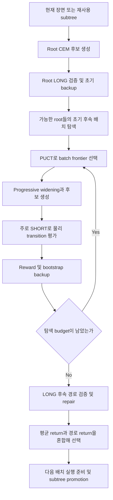

# MCTS 알고리즘: Appendix 상세 정의 초안

논문 [본문 초안](mcts-algorithm.md)을 뒷받침하는 구현 세부사항이다.
Appendix 편집 시 수식·설정·예외 정책의 근거 자료로 사용한다.

**확인일: 2026-10-21.** 현재 working tree의 공통 MCTS 구현과 플랫폼별 기본
profile을 설명한다. 알고리즘 흐름과 주요 수식을 중심으로 정리했으며, 실험에는
실제 사용한 profile·runtime override·backend 버전을 기록해야 한다.

관련 문서:

- [초기 자세 후보 생성](initial-pose-sampling-summary.md)
- [Settling·structural·robustness simulation](mcts-simulation.md)
- [상세 MCTS 전략](mcts-strategy.md), [batch scheduling](mcts-batching.md)

## 1. 탐색 문제와 전체 구조

MCTS는 현재 구조물에서 **다음 돌의 선택과 배치 자세**, 그리고 그 이후의 배치
가능성을 탐색한다. 한 번의 search가 끝나면 다음 배치 하나를 선택하고, 선택한
subtree를 다음 search에 재사용할 수 있다.

상태 $s$는 이미 놓인 돌들의 ID·순서·자세, 남은 inventory, 접촉과 trajectory,
고정된 관측 물체 등의 정보를 담는다. Action $a=(i,T_i)$는 아직 놓지 않은 돌
$i$와 posegen으로 최적화한 6-DoF 배치 자세 $T_i$다. 시뮬레이션은 새 돌과
기존 돌의 최종 자세를 계산해 child state를 만든다.

각 node는 incoming action, 평가된 상태, 즉시 reward $r$, prior logit $\ell$,
방문 횟수 $N$, 누적 return $W$를 보관한다. 후보를 붙였지만 시뮬레이션하지 않은
node는 pending 상태이며, 물리 검사에 실패한 node는 선택에서 제외한다.



그림은 현재 CUDA 기본 경로다. 후보·후속 경로가 없으면 아래의 bounded retry와
fallback을 적용한다. 실제 grasp/motion planning은 MCTS가 선택한 배치 후보를
입력으로 받아 별도 수행한다.

## 2. Action generation과 root population

일반 node에서는 부피에 비례해 돌별 proposal budget을 배정하고, orientation bank와
XY score grid에서 초기 자세를 만든다. 현재 공간 점수는
$S=-3H+2Q+2F+1.5B$이며, contact height·support coverage·unfilled area·boundary
proximity를 반영한다. Empty scene은 가능한 corner seed를 우선 사용하고, 이후에는
active lower floor 후보를 우선한다. 후보마다 Z 초기화, posegen, solved-pose
filter를 거친다.

Root에서는 이 generator를 CEM population refinement로 감싼다. CUDA 기본값은
population 96, elite 최대 32, 총 3 rounds다. 첫 population 이후 매 round의 절반은
fresh proposal, 절반은 elite의 초기 XY·yaw에 Gaussian perturbation을 준 mutation이다.
각 mutation도 Z 초기화와 posegen을 다시 수행한다. 분산은 고정되어 있으며,
elite에서 adaptive covariance를 추정하지 않는다.

### 서로 다른 점수의 역할

| 점수 | 사용 위치 | 현재 기본 형태 |
|---|---|---|
| $S$ | Stone 내부의 XY/orientation 샘플링 | $-3H+2Q+2F+1.5B$ |
| $\ell$ | Tree child의 prior logit | $-2\operatorname{clip}(E,0,1)+2C$ |
| $J_{\mathrm{CEM}}$ | Root population의 elite/최종 후보 정렬 | $\ell+\widetilde S$ |
| $r$ | 시뮬레이션 transition 이후 reward | 안정성·포함률·채움·robustness·형상 항의 가중합 |

$E$는 posegen의 dimensionless equilibrium residual, $C$는 후보 돌의 target
containment, $\widetilde S$는 정규화한 proposal score다. $\ell$의 기본 planar
weight는 0이다. 따라서 CEM이 $\widetilde S$로 좋은 초기 후보를 남기더라도,
tree에 저장하는 prior는 `PlacementPriorScorer`에서 다시 계산한다. Historical
action에 $E$가 없으면 legacy equilibrium scaling을 사용한다.

## 3. Selection: PUCT와 batch reservation

평가된 child $j$의 prior probability는 sibling logit의 softmax로 계산한다.

$$
P_j=\frac{\exp(\ell_j)}{\sum_k\exp(\ell_k)}.
$$

평균 return과 탐색 bonus를 결합한 선택 점수는

$$
U_j=
\frac{W_j}{N_j+V_j}
+cP_j\frac{\sqrt{\max(N_p+V_p,1)}}{1+N_j+V_j}.
$$

여기서 $p$는 parent, $V$는 현재 batch에서만 쓰는 virtual visit이고 분모가 0인
평균은 0으로 둔다. CUDA 기본 탐색 상수는 $c=1$. Pending action이 있으면
평가된 child의 PUCT 비교보다 먼저 prior가 높은 pending action을 선택한다.

한 batch를 구성하는 동안 선택한 경로에 임시 방문을 예약해 동일 action의 중복
평가를 피한다. 동일 root branch에서 서로 다른 action을 여러 개 선택할 수 있으며,
일반 batch에 branch별 동일 quota를 강제하지 않는다. 이 방식은 PMBS 스타일의
zero-return virtual count를 사용한다. 실제 node의 $N,W$는 예약 때문에 바뀌지
않으며, batch 종료나 예외 후에도 virtual visit이 남지 않는다.

남은 simulation capacity로 pending sibling을 미리 평가할 수 있다. 이 sibling은
나중에 선택될 때까지 backup visit을 받지 않는다. Tree selection과 backup은
CPU에서 수행하고, native posegen·simulation 작업을 CPU worker 또는 CUDA에 배치한다.

## 4. Expansion: progressive widening과 시도 한도

Root의 child 한도는 고정한다. 일반 node는 완료된 방문 수에 따라 selectable
child 수를 늘린다.

$$
K(N)=\min\left(K_{\max},\left\lceil3\max(N,1)^{0.5}\right\rceil\right),
\qquad K_{\max}=16.
$$

예를 들어 방문 수가 1이면 최대 3개, 4이면 6개의 selectable child를 허용한다.
Virtual visit은 widening에 사용하지 않는다. 생성에 실패한 후보도 시도 한도를
소비하며, 일반 node의 accepted/rejected 합산 generation budget은

$$
A_{\max}=\max(K_{\max},\lceil3K_{\max}\rceil)=48
$$

이다. 한 번의 generation 요청은 최대 32이며, 재시도는 widening 여유, 누적
attempt, deadline에 의해 추가로 제한된다. `min_feasible_children=3`은 생성 목표이며
물리 검사를 통과하는 child 3개를 보장하지 않는다.

Root CEM 내부의 population attempt는 별도 통계다. Tree에 반환되는 candidate 수와
모든 posegen 실행 횟수는 같지 않으므로 root의 tree attempt counter만으로 native
계산량을 추정하면 안 된다.

## 5. Transition evaluation과 reward

평가는 **fixed-scene settling → structural simulation → 조건부 velocity-disturbance
robustness** 순으로 진행한다. 일반 descendant는 SHORT, root 및 최종 후속 경로는
LONG으로 검증한다. LONG 재평가는 부모 장면에서 시작하며 기존 SHORT child의
시뮬레이션을 그대로 이어 실행하지 않는다. 상세 조건은
[시뮬레이션 문서](mcts-simulation.md)에 정리되어 있다.

물리 검사 외에도 target containment, settled 여부, active-floor 조건에 따라
node를 거절할 수 있다. 실패 node는 이후 탐색에서 제외하며 backup에는 별도의
`failure_reward=-1`을 사용한다.

성공 transition의 현재 기본 reward는 다음과 같이 요약할 수 있다.

$$
\begin{aligned}
r(s,a,s')={}&-2\operatorname{clip}(E,0,1)
+2\operatorname{clip}(C-0.5,0,1)
+\frac{CV_i}{\bar V}\\
&-2\frac{\overline D}{D_{\mathrm{ref}}}
-2\frac{h_{\max}-h_{\mathrm{mean}}}{\bar V^{1/3}}
+w_{\mathrm{in}}A_{\mathrm{in}}.
\end{aligned}
$$

| 기호 | 의미 |
|---|---|
| $E$ | Action에 기록된 posegen equilibrium residual. Structural simulation 후 새로 푼 equilibrium 값은 아님 |
| $C$ | Nominal 시뮬레이션 후 새 돌의 containment fraction |
| $V_i,\bar V$ | 새 돌의 부피와 초기 inventory의 고정 평균 부피. 부피는 convex-component volume 합으로 계산 |
| $\overline D,D_{\mathrm{ref}}$ | Reward용 처리 후 peak excursion과 플랫폼별 기준 길이 |
| $h_{\max},h_{\mathrm{mean}}$ | Target 위 32 × 32 surface grid의 최대·평균 높이. 빈 바닥 포함 |
| $A_{\mathrm{in}}$ | 대표 component-face 법선의 위쪽·target 안쪽 정렬 점수 |

$w_{\mathrm{in}}$은 excavator에서 0, tabletop에서 2다. Excavator는 현재 이
orientation reward를 사용하지 않는다. 상세 정의는
[Reward appendix](reward-design-appendix.md)를 참고한다.
`large_object_lower` 항의 현재 가중치는 양 플랫폼 모두 0이다. 포함 부피 항 $CV_i/\bar V$는
새 돌의 contained volume을 평균 돌 부피로 나눈 값이며, 전체 구조물의 union IoU를
직접 계산한 보상이 아니다. 새 돌을 크게 선택하려는 proposal bias와 reward에서
포함 부피를 선호하는 효과는 구분해서 해석해야 한다.

## 6. Leaf value와 backup

현재 leaf 이후에 random action rollout을 추가하지 않는다. Nonterminal,
nonfailed leaf에는 고정 expected-reward horizon 값을 사용한다.

$$
h=\min(H_B,d_{\max}+1-d_{\mathrm{leaf}},n_{\mathrm{remaining}}),
\qquad
B=\mu\sum_{j=0}^{h-1}\gamma^j.
$$

CUDA와 tabletop 기본값은 $\mu=1$, $H_B=4$, $\gamma=0.9$다. 현재 코드의
discount convention은 다음과 같다.

```text
G = gamma * B                  # terminal/failed leaf이면 B = 0
for node in leaf -> root:
    r = failure_reward if node.failed else node.reward
    G = r + gamma * G
    node.N += 1
    node.W += 0 if node.failed else G
```

따라서 nonterminal leaf가 받는 sample은 **$r_{\mathrm{leaf}}+\gamma^2B$**다.
이는 caller가 bootstrap을 한 번 discount한 뒤 backup loop에서 다시 discount하는
현재 구현을 그대로 나타낸다. Failed node 자신은 0-valued visit을 기록하지만,
ancestor의 return에는 failure reward가 전달된다.

Root LONG 준비 과정에서도 검증된 root 후보에 초기 backup visit을 준다.
따라서 iteration, simulation 평가 횟수, node 수, visit 수는 서로 다르다.

## 7. 최종 선택: 평균 return과 검증된 continuation

Root child $a_0$의 평균 backed-up value를 $M(a_0)$라 하고, 그 아래 $k$개의
후속 배치를 포함한 검증 경로 return을

$$
D_k(a_0)=r(a_0)+\sum_{j=1}^{k}\gamma^j r(a_j)
$$

로 둔다. 현재 CUDA 기본값은 $k=2$이므로 선택할 현재 배치와 그 뒤 두 배치를
함께 본다. 남은 tree depth에 따라 $k$를 줄이며 terminal 경로는 일찍 끝날 수 있다.

| 모드 | 최종 점수 |
|---|---|
| `mean` | $M$ |
| `max_descendant` | $D_k$ |
| `mixed` | $(1-\lambda)M+\lambda D_k$ |

현재 기본 모드는 `mixed`, $\lambda=0.5$다. Authoritative root 준비에서 backup한
후보는 MCTS 평균 $W/N$을 $M$으로 사용한다. 그 외에는 별도로 기록한 최종 검증
reward가 있으면 이를 우선한다.

최종 경로 검증은 알려진 return 순서로 continuation을 확인하고 처음 성립하는
경로를 사용한다. 모든 가능한 LONG 경로를 완전 탐색한 최댓값을 보장하지 않는다.
Repair 단계는 발견된 authoritative continuation 중 최대 return을 계산한다.

$M$에는 SHORT 결과와 bootstrap의 영향이 남을 수 있고, $D_k$는 LONG으로
확인한 경로의 reward를 사용한다. 따라서 최종 점수를 전체 LONG 재계산 결과로
해석하면 안 된다. 이미 authoritative LONG으로 평가된 node는 재사용한다.

## 8. Continuation repair와 fallback

물리적으로 가능한 root가 후속 배치를 찾지 못하면 다음 순서로 복구를 시도한다.

1. **Continuation repair:** 검증된 prefix를 보존하고 부족한 아래 경로에서 후보를
   생성한다. 새 child는 SHORT로 screening하고 통과 후보를 LONG으로 확인한다.
   다른 root가 이미 유효한 경로를 가져도 이 repair를 수행할 수 있다.
2. **Descendant floor relaxation:** Root placement와 검증 결과는 보존한 채
   후속 배치의 floor admission만 완화해 한 번 더 repair한다.
3. **Root retry:** 최종 선택이 여전히 없으면 앞선 root들을 제외한 새 CEM pool을
   만들고 LONG 검증·lookahead·최종 선택을 반복한다. 기본 추가 retry는 최대 3회다.
4. **Sampling fallback:** Empty scene이면 corner 제한을 풀고 ordinary sampling을,
   이후에는 floor admission을 완화한 새 root pool을 시도한다. Lower-floor priority,
   fill-area score, sampling connectivity와 물리 검증은 유지한다.
5. **마지막 descendant-requirement 완화:** 위 과정과 시간 budget을 소진해도 경로가
   없으면, placement 자체는 authoritative LONG 검증을 통과했던 root 중 평균 점수가
   가장 좋은 것을 선택할 수 있다. 이전 retry pool의 후보도 포함한다.

마지막 단계는 후속 경로 검증 요구만 완화한다. 물리적으로 실패한 root나 execution
제외 후보를 되살리지 않으며, `validated_descendant_fallback` diagnostic으로 남긴다.
따라서 `require_validated_descendant: true`는 모든 최종 선택에 후속 경로가 있다는
무조건적인 보장이 아니다.

일반 repair 호출의 round 상한은
`expansion_retry_batches × required_descendant_depth`다. 현재 CUDA는 최대 6 rounds,
round당 logical evaluation batch 256까지이며, widening·attempt·deadline으로
더 일찍 끝날 수 있다. Resource capacity 오류는 sampling retry와 별도로 search를
중단한다.

## 9. 시간 budget과 subtree 재사용

CUDA는 전체 240 s 중 마지막 60 s를 검증과 repair 등에 남겨, 일반 탐색 deadline을
180 s로 둔다. Root 준비도 이 초기 deadline의 영향을 받는다. 이미 실행 중인 native
호출은 즉시 취소되지 않으므로 실제 종료가 deadline을 넘을 수 있다.

선택한 root child를 다음 root로 promote하면 그 아래 후보·평가 상태를 보존한다.
관측 장면을 입력받아 root state를 갱신할 수도 있다. 다음 search에서는 유지한
child를 재검증하고, 검증 전후 공통 물체의 최대 위치 변화가 `max_state_drift=0.1`
보다 크면 그 node의 descendants를 제거한다. 이 drift 기준은 회전 변화가 아닌
translation 기준이다.

Promotion은 새 root의 generation attempt/cursor를 초기화한다. 기본 request의
`reset_statistics: true`는 방문 수와 누적 return도 재귀적으로 초기화하므로,
재사용되는 것은 주로 tree 구조와 후보·평가 결과다. 완화된 floor 정책으로 만든
즉시 continuation은 다음 배치에서 strict 정책으로 재구성한다.

Motion/execution에서 거절된 action 또는 object는 session에 기록하고 이후 생성·선택에서
제외할 수 있다. Search 결과는 다음 배치 하나의 선택이며, 예측 descendant들을
모두 실행하는 명령이 아니다.

## 10. 현재 profile 비교

| 항목 | Excavator CPU | Excavator CUDA | Tabletop CPU | Tabletop CUDA |
|---|---:|---:|---:|---:|
| 최대 depth | 3 | 4 | 4 | 4 |
| Iteration budget | 1,024 | 1,024 | 1,024 | 1,024 |
| 전체 시간 / 검증 reserve | 240 / 30 s | 240 / 60 s | 240 / 60 s | 240 / 60 s |
| Root / 일반 child 한도 | 12 / 16 | 32 / 16 | 32 / 16 | 32 / 16 |
| PUCT 상수 $c$ | 2 | 1 | 1 | 1 |
| 초기 depth-1 구간 | 8개 돌을 놓기 전까지 | 없음 | 없음 | 없음 |
| Logical evaluation batch | 12 | 256 | 12 | 256 |
| Native/result CPU worker 설정 | 12 | 4 | 12 | 4 |
| CEM population / elite / rounds / keep | 96 / 24 / 3 / 12 | 96 / 32 / 3 / 32 | 96 / 32 / 3 / 32 | 96 / 32 / 3 / 32 |
| Mutation XY 표준편차 | 0.10 m | 0.20 m | 0.01 m | 0.01 m |
| 검증 descendant 깊이 $k$ | 1 | 2 | 2 | 2 |
| Bootstrap $\mu$ / horizon | 2.5 / 4 | 1 / 4 | 1 / 4 | 1 / 4 |

모든 profile은 discount 0.9, root LONG 준비, root lookahead, mixed selection을
사용한다. `simulation_depth=5`는 추가 rollout 길이가 아니라 depth별 simulation
fidelity 전환값이다. 현재 최대 depth보다 커서 일반 탐색의 깊이 조건만으로 LONG으로
전환되는 node는 없다.

CUDA의 tree selection·backup은 CPU 작업이며, posegen capacity 512와 simulation
placement chunk 128은 logical MCTS batch 256과 별개다. 유효 후보가 적으면 batch는
설정값보다 작아진다. Excavator CPU의 초기 depth-1 구간에는 descendant 검증 깊이도
0으로 제한되므로 첫 배치부터 lookahead하는 CUDA/tabletop과 동작이 다르다.

2026-10-21 구현은 action copy에서 nested diagnostics를 read-only로 공유한다.
Branch별 최상위 diagnostics mapping은 분리하고, 공유된 nested 값의 in-place
수정은 차단한다. 이는 상태 복사의 비용을 줄이는 구현 변경이며 PUCT·reward·backup
수식의 변경은 아니다. CUDA robustness history chunk의 추정 budget은 1.5 GiB다.

## 11. 코드 근거와 검증 범위

| 항목 | 소스 |
|---|---|
| Search·root 준비·repair·최종 선택 | [search.py](../packages/stacking-common/src/stacking_common/search/mcts/search.py) |
| Node 데이터와 visit 통계 | [node.py](../packages/stacking-common/src/stacking_common/search/mcts/node.py) |
| PUCT·widening·attempt 한도 | [tree_policy.py](../packages/stacking-common/src/stacking_common/search/mcts/tree_policy.py) |
| Discounted backup | [backup.py](../packages/stacking-common/src/stacking_common/search/mcts/backup.py) |
| Session과 subtree promotion | [session.py](../packages/stacking-common/src/stacking_common/search/mcts/session.py) |
| Prior와 leaf bootstrap | [policies.py](../packages/stacking-common/src/stacking_common/search/policies.py) |
| Root population refinement | [cem.py](../packages/stacking-common/src/stacking_common/actions/cem.py) |
| Transition reward | [reward.py](../packages/stacking-common/src/stacking_common/environment/reward.py) |
| Platform 구성 | [workflows/search.py](../packages/stacking-common/src/stacking_common/workflows/search.py) |
| Profile → runtime 설정 | [profiles/mcts.py](../packages/stacking-common/src/stacking_common/profiles/mcts.py) |
| Excavator 설정 | [CPU](../apps/excavator/config/mcts_cpu.yml), [CUDA](../apps/excavator/config/mcts_cuda.yml), [reward](../apps/excavator/config/environment.yml) |
| Tabletop 설정 | [CPU](../apps/tabletop/config/mcts_cpu.yml), [CUDA](../apps/tabletop/config/mcts_cuda.yml), [reward](../apps/tabletop/config/environment.yml) |

Iteration 수만으로 탐색 coverage나 성능을 비교하지 않는다. 생성 node 수,
SHORT/LONG 평가 수, root/descendant 검증 실패, fallback 사용, 최종 reward,
배치 성공률과 wall time을 함께 기록해야 한다. 이 문서는 현재 코드의 설명이며,
새로운 적층 성공률이나 native CPU/GPU 성능 개선을 검증한 결과는 아니다.

이번 확인에서는 기존 `test_mcts_core.py`, `test_mcts_pmbs.py`,
`test_mcts_repair.py`, `test_mcts_session.py`, `test_mcts_search.py`를 실행해
**112개 테스트가 모두 통과**했다. Tree policy, batch reservation, backup,
최종 검증·repair·fallback과 subtree 재사용을 확인한 결과다.
