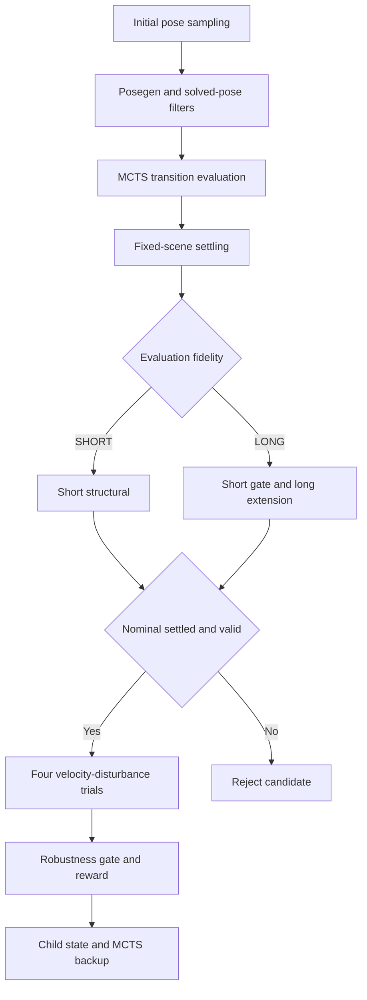

# MCTS의 placement simulation 구성

> Historical staged-simulation description. The runtime strategy changed on
> 2026-10-27: see [Unified MCTS simulation](mcts-unified-simulation.md) for the
> current single simulation, depth filter, and subtree reuse behavior.

**확인일: 2026-10-21.** 현재 working tree의 공통 구현과 excavator/tabletop
기본 설정을 기준으로 정리한다. 초기 후보 생성은
[Initial placement sampling](initial-pose-sampling-summary.md)을 참고한다.
전체 tree search와 최종 선택은 [MCTS 알고리즘](mcts-algorithm.md)에 정리되어 있다.

## 1. 전체 흐름

질문에서 구분한 세 역할은 현재 구현에도 존재한다.

| 단계 | 목적 | 움직이는 물체 | 출력 |
|---|---|---|---|
| Fixed-scene settling | Posegen 결과를 기존 구조물 위에 내려놓고 접촉 자세 정리 | 새 돌만 dynamic, 기존 돌은 모두 static | Settling 후 자세와 접촉 |
| Structural simulation | 새 돌이 기존 구조물에 미치는 영향과 전체 안정화 평가 | 새 돌과 고정 대상으로 지정되지 않은 기존 돌 | Nominal 최종 장면, trajectory, 접촉, 안정화 여부 |
| Placement robustness | 초기 속도 외란에 대한 구조물의 회복과 최대 움직임 평가 | Nominal structural 단계의 dynamic 역할 유지 | 외란별 excursion, 실패 사유, reward penalty |

Posegen과 CEM은 배치 후보를 생성·최적화한다. 위 시뮬레이션들은 후보가
MCTS의 **state transition으로 평가될 때** 실행된다. 따라서 CEM에서 최적화된
모든 후보가 즉시 세 단계의 시뮬레이션을 받는 것은 아니다.

LONG 안의 `short gate → long extension`과 MCTS의 `SHORT → LONG 재평가`는
호출 방식이 다르다. 전자는 한 시뮬레이션의 연속 단계이고, 후자는 부모 장면에서
시작하는 별도 transition 평가다.

## 2. Fixed-scene settling: 기존 scene을 고정한 자세 정리

입력은 부모 상태의 기존 돌 자세와 posegen이 반환한 새 돌의 자세다. 바닥과
기존 돌을 고정하고 **새 돌 하나만** 중력과 접촉에 따라 움직인다. 기존 구조물이
움직여 후보의 초기 접촉 오차를 흡수하지 않도록 한 상태에서 새 돌을 내려놓는다.

양 플랫폼 모두 다음 설정을 사용한다.

- 접촉 모델: `single_point`.
- 적분 간격: 0.01 s.
- 적분 횟수: 400 steps, 즉 **시뮬레이션 시간 4 s**.
- 실행 길이는 고정되어 있으며 structural 단계의 quiet-window 종료 조건을
  사용하지 않는다.

이후 structural scene을 새로 구성한다. Settling의 **최종 자세는 유지하고
속도는 0으로 초기화**한다. 따라서 structural 평가는 새 돌의 낙하 속도가 남은
상태 대신, 접촉 자세가 정리된 정지 상태에서 시작한다.

여기서 말하는 4 s는 물리적 적분 시간이다. 실제 CPU/GPU 실행 시간과는 다르다.

## 3. Structural simulation: SHORT와 LONG

### 3.1 물체의 고정 여부

Structural 단계에서는 새 돌과 기존 돌이 기본적으로 dynamic이다. 다음 물체는
static으로 유지한다.

1. 부모 상태의 `pose_identified_object_ids`에 포함된 기존 돌.
2. SHORT에서 거리 조건으로 동결한 기존 돌.
3. 바닥.

SHORT는 새 돌에서 멀리 떨어진 기존 돌을 동결해 평가 범위를 줄인다. 다만
settling 접촉 그래프에서 새 돌을 지지하는 아래 방향 support chain은 동결에서
제외한다. 거리 기준은 돌 중심의 XY 거리이며, 현재 반경은 excavator 1.5 m,
tabletop 0.10 m다. LONG은 이 거리 동결을 사용하지 않지만, pose-identified
기존 돌의 고정 역할은 유지한다.

### 3.2 시간과 종료 조건

두 fidelity는 모두 `limit_surface_6d` structural 접촉 모델을 사용한다.
현재 `patch_eps`는 양 플랫폼 모두 0.00003 m다. SHORT/LONG의 차이는 주로
시간 한도, quiet window, 거리 동결에 있다.

| 항목 | SHORT | LONG의 최종 structural 기준 |
|---|---:|---:|
| 적분 간격 | 0.01 s | 0.01 s |
| 최소 경과 시간 | 0.5 s | 3.0 s |
| 최대 경과 시간 | 4.0 s | 15.0 s |
| 요구 quiet steps | 20 | 150 |
| Inventory의 마지막 돌일 때 | 40 | 300 |
| 거리 동결 | 사용 | 사용하지 않음 |

LONG backend는 내부적으로 short gate를 실행한 뒤 long extension으로 진행한다.
이때 자세, 속도, 누적 motion integral, 경과 시간, quiet counter를 이어받는다.
따라서 최대 15 s는 short gate 이후에 추가하는 15 s가 아니라 **누적 structural
시간 한도**다. 이전 단계에서 motion limit을 넘은 경우에는 extension이 생략된다.

SHORT fidelity용 profile loader는 short 설정을 주 structural 설정으로 바꾸고
별도 short gate를 제거한다. 따라서 SHORT 평가는 short structural 한 단계다.

### 3.3 안정화와 과도한 움직임의 판단

돌 $b$의 선속도 $v_b$, 각속도 $\omega_b$, 질량 $m_b$, 관성 $I_b$에 대해
구현은 다음 mass-normalized kinetic-energy 지표를 사용한다.

$$
e_b(t)=\|v_b(t)\|_2^2+
\frac{\omega_b(t)^\mathsf T I_b\omega_b(t)}{m_b},
\qquad
M_b(t)=\int_0^t\sqrt{e_b(\tau)}\,d\tau.
$$

$e_b$는 통상적인 운동에너지 $K_b$의 $2K_b/m_b$에 해당한다. $M_b$는 회전
운동도 포함하는 누적 움직임 지표이므로 위치 변화량과 구별해야 한다.

- 최소 시간 이후 모든 모니터링 물체의 $e_b$가 threshold 아래인 quiet 상태를
  요구 step 수만큼 충족하면 settled로 판단한다.
- 어느 돌의 $M_b$라도 motion threshold를 넘으면 불안정 후보로 거절한다.
- 최대 시간까지 안정화되지 않은 결과는 MCTS adapter에서
  `simulation_unsettled`로 거절한다.
- 접촉 침투와 새 돌의 support source도 검사한다. 현재 minimum support count는
  1이며, 첫 돌에는 별도의 support-count 예외가 있다.

| 플랫폼 | Energy threshold | Motion-integral threshold | 접촉 gap 허용값 |
|---|---:|---:|---:|
| Excavator | $10^{-5}$ | 0.2 | 0.02 m |
| Tabletop | $10^{-6}$ | 0.05 | 0.01 m |

## 4. MCTS가 SHORT와 LONG을 사용하는 위치

현재 CUDA MCTS 기본 설정은 양 플랫폼에서 다음과 같다.

| 평가 위치 | 사용 방식 |
|---|---|
| 일반 tree expansion | 기본 SHORT |
| Root 후보 검증 | `root_before_search: true`에 따라 LONG으로 검증 후 후속 탐색 |
| 최종 root 선택 | LONG 검증이 없는 후보를 LONG으로 확인; 이미 authoritative LONG 결과가 있으면 재사용 |
| 최종 descendant path | 검증할 후속 경로를 LONG으로 확인; 현재 CUDA의 `validate_descendant_depth`는 2 |
| 깊이 기준 전환 | `depth > simulation_depth`이면 LONG; 현재 `simulation_depth=5`, `max_depth=4`여서 일반 탐색에서는 이 조건에 도달하지 않음 |

따라서 현재는 **root/final-path 검증이 LONG을 사용하는 주요 경로**이고, 일반
descendant 탐색은 SHORT가 중심이다. 후속 경로 검증도 남은 depth, 후보 유무,
deadline의 영향을 받는다. Excavator CPU profile의 descendant 검증 깊이는 1이고,
tabletop CPU와 양 플랫폼 CUDA profile은 2다.

LONG 재평가는 부모 상태와 해당 action을 입력으로 settling부터 다시 실행한다.
이전에 저장된 SHORT child snapshot을 그대로 연장하지 않는다. 새 LONG 결과가
기존 child state와 크게 달라지면 그 아래 subtree를 비울 수 있다.

## 5. Placement robustness: 속도 외란에 대한 회복 평가

### 5.1 시작 장면과 외란

Nominal structural 결과가 **settled이고 backend의 물리 검사를 통과한 경우**에
외란 trial을 실행한다. 이 기능은 SHORT와 LONG backend에 모두 연결되어 있다.
Containment 및 settled-floor 같은 상위 검사는 이후에도 후보를 거절할 수 있다.

각 trial은 nominal structural 최종 snapshot에서 독립적으로 시작한다.

- 모든 돌의 자세와 static/dynamic 역할을 유지한다.
- 남아 있는 속도를 0으로 만든 후 **새 돌에만** Gaussian 초기 속도를 준다.
- 선속도는 world XYZ, 각속도는 body XYZ 축 기준으로 샘플링한다.
- Dynamic support stones도 움직이며, peak excursion과 회복 여부를 함께 평가한다.
- Trial 결과는 nominal 최종 자세나 MCTS의 child scene을 덮어쓰지 않는다.

$$
v_{\mathrm{new}}^{(k)}\sim\mathcal N(0,\operatorname{diag}(\sigma_v^2)),
\qquad
\omega_{\mathrm{new}}^{(k)}\sim\mathcal N(0,\sigma_\omega^2 I_3).
$$

현재는 위치·회전 자세를 바꾸는 pose-noise 방식 대신 이 velocity-disturbance
방식을 사용한다. 접촉 자세는 유지하면서 release 시 잔류 속도에 대한 반응을
평가하며, 로봇의 접근·삽입 가능성은 별도의 motion planning에서 다룬다.

### 5.2 Peak excursion과 reward

Trial $k$의 dynamic body $b$에 대해 nominal 자세 $(p_b^0,q_b^0)$에서의
움직임을 매 적분 step마다 확인한다. 최종 시점까지의 최대값을

$$
D=\max_{k,b,t}\left[
\|p_b^{(k)}(t)-p_b^0\|_2+
\lambda\,\theta(q_b^{(k)}(t),q_b^0)\right]
$$

로 정의한다. $\theta$는 quaternion 사이의 최단 회전각(rad), $\lambda$는
m/rad 단위의 회전 가중치다. 따라서 돌이 크게 움직인 뒤 원위치로 돌아와도
그 움직임이 평가에 남는다.

Reward에는 다음 penalty가 들어간다.

$$
R_{\mathrm{place}}=-w_{\mathrm{place}}
\frac{\overline D}{D_{\mathrm{ref}}},\qquad w_{\mathrm{place}}=2.
$$

$\overline D$는 reward 계산용으로 nonfinite 대체와 clipping을 적용한 값이다.
실패 여부는 원래 excursion과 trial 사유로 판단하며, reward clipping으로 실패가
취소되지 않는다.

| 항목 | Excavator | Tabletop |
|---|---:|---:|
| Trial 수 | 4 | 4 |
| 선속도 표준편차, 각 축 | 0.05 m/s | 0.02 m/s |
| 각속도 표준편차, 각 축 | 5°/s | 5°/s |
| 회전 가중치 $\lambda$ | 0.1 m/rad | 0.01 m/rad |
| Excursion 실패 한도 | 0.15 m | 0.015 m |
| Reward reference $D_{\mathrm{ref}}$ | 0.15 m | 0.015 m |
| `reject_failed_trials` | true | true |
| Bounded-rocking 허용 window 범위 | 2 mm, 0.5° | 비활성 |

### 5.3 Trial의 종료와 실패

Trial은 structural physics와 현재 fidelity의 시간/quiet-window 설정을 사용하되,
**timestep을 두 배인 0.02 s로** 설정한다. Quiet step 수는 유지하므로 quiet
window의 물리적 길이도 두 배가 된다. 의도적으로 준 초기 외란을 평가하기 위해
nominal structural의 누적 motion-integral cutoff는 사용하지 않는다.

모든 dynamic body가 에너지 기준으로 안정화되면 성공이다. 에너지 quiet 조건을
충족하지 않아도 excavator는 마지막 window의 위치·회전 범위가 표의 한도 이내인
경우 `bounded_rocking`으로 인정한다. 이 경우에도 excursion penalty는 남는다.
현재 두 플랫폼은 회복하지 못한 trial이 있으면 후보를 `place_robustness`로 거절한다.
Nonfinite 결과, 누락된 history, excursion 한도 초과는 강제 실패다.

## 6. 별도로 존재하는 fixed-scene re-settling

MCTS 이후 **선택 후보를 실제 motion-planning 문제로 변환하는 단계**에서도
`settle_fixed()`가 호출된다. Excavator planning coordinator는 이 경로를 사용하며,
tabletop coordinator도 placement backend가 주입된 경우 이 경로를 사용한다.

이때는 확정된 기존 장면을 모두 고정한 뒤 선택된 새 돌만 다시 settling한다.
결과 자세로 floor 조건을 재확인하고 grasp/motion planning 입력을 구성한다.
이 호출은 settling만 실행하며 structural/robustness를 추가 실행하지 않는다.
특히 `settle_fixed()`의 `settled` 표시는 유한한 결과가 생성되었다는 의미이며,
structural quiet-window 검증과 동일한 보증을 주지는 않는다.

MCTS의 동역학 장면은 돌과 ground plane으로 구성된다. Target shape는 posegen의
목표와 containment 평가에 쓰이며, 이 동역학 장면에 별도의 target 벽 rigid body를
추가하지 않는다. 굴착기/로봇 URDF의 구동·접촉 시뮬레이션도 이 모듈의 평가에
포함되지 않는다.

## 7. CPU/CUDA 실행과 결과 기록

CPU와 CUDA는 동일한 단계 구성을 사용한다. CUDA는 독립 후보 장면들을 batch로
계산한다. 현재 MCTS evaluation batch는 256, transition의 placement chunk는
128, native simulation job capacity는 512다. 후보 128개에 trial 4개가 붙으면
robustness job은 최대 512개가 되며, per-step history 다운로드는 추정 **1.5 GiB**
sample-storage budget에 따라 더 작은 chunk로 나뉠 수 있다. 이 값은 전체 simulator
메모리 한도가 아니다. 2026-10-21 변경 전의 budget은 512 MiB였으며, 현재는 더 큰
trial chunk로 native 호출 횟수를 줄인다. 실제 chunk 크기는 step 수와 body capacity에
따라 달라진다.

Short/long은 별도 backend/environment를 갖는다. 후보 간 부모 상태와 nominal
장면을 분리하고, 시뮬레이션 결과로 각 child state를 만든다. 반환된 nominal
자세는 새 돌뿐 아니라 움직인 기존 돌에도 반영된다.

기록을 확인할 때 유용한 diagnostic은 다음과 같다.

| Diagnostic | 의미 |
|---|---|
| `simulation_settling_wall_seconds` | 첫 settling의 실제 계산 시간 |
| `simulation_stage_times`, `simulation_elapsed` | Structural 적분 경과 시간 |
| `simulation_structural_wall_seconds` | Structural의 실제 계산 시간 |
| `simulation_frozen_object_indices` | Structural에서 거리 조건으로 동결한 돌 |
| `simulation_velocity_integrals` | Nominal 구조물의 누적 움직임 |
| `place_robustness_evaluated` | 실제 외란 trial 실행 여부 |
| `place_robustness_trial_outcomes` | `settled`, `bounded_rocking` 또는 실패 사유 |
| `place_robustness_raw_displacement` | Trial/body/시간에 대한 최대 excursion |
| `simulation_robustness_wall_seconds` | Robustness 계산 시간 |
| `fixed_scene_resettle_*` | Motion planning 전 별도 re-settling 기록 |

CUDA batch에서 wall-time diagnostic 일부는 batch 시간을 후보 수로 나눈 값이다.
개별 후보만 단독 실행한 latency로 해석하지 않는다.

## 8. 논문용 요약 문단

> Each placement hypothesis is first settled with the existing stack fixed,
> allowing only the new stone to move. The resulting poses initialize a
> structural simulation from rest, in which eligible supporting stones are
> released. Short simulations screen tree expansions, while root and selected
> continuation candidates receive longer validation; distant non-supporting
> stones may remain fixed during short evaluations. For nominally settled,
> physically admissible results, four independent trials apply Gaussian initial
> linear and angular velocities to the newly placed stone. Robustness is measured
> by the worst peak translation-plus-weighted-rotation excursion across all
> dynamic stones and trials. This quantity contributes a normalized reward
> penalty, and trials exceeding motion or recovery criteria reject the candidate.
> Disturbed trajectories are used for evaluation, while the nominal structural
> result defines the search transition.

## 9. 코드 및 설정 근거

| 항목 | 근거 |
|---|---|
| Backend와 SHORT/LONG 환경 구성 | [workflows/search.py](../packages/stacking-common/src/stacking_common/workflows/search.py): `build_core_backend`, `build_search_environments` |
| Settling, structural, 고정 역할, 물리 검사 | [core_backend.py](../packages/stacking-common/src/stacking_common/environment/core_backend.py): `place`, `_settle`, `_simulate_structural`, `_short_frozen_indices`, `settle_fixed` |
| CUDA batch 및 연속 phase | [cuda_backend.py](../packages/stacking-common/src/stacking_common/environment/cuda_backend.py): `_place_chunk`, `_robustness`, `_robustness_phase` |
| 외란, peak excursion, rocking 판정 | [robustness.py](../packages/stacking-common/src/stacking_common/environment/robustness.py): `disturbance_scene`, `disturbance_phase`, `trial_outcome` |
| 결과의 state/action 반영 | [transition.py](../packages/stacking-common/src/stacking_common/environment/transition.py): `_result_state` |
| Settled/containment/floor 후속 거절 | [adapters.py](../packages/stacking-common/src/stacking_common/search/adapters.py): `_evaluation`, `_transition_rejection_reason` |
| MCTS fidelity 및 LONG 재평가 | [search.py](../packages/stacking-common/src/stacking_common/search/mcts/search.py): `_tree_fidelity`, `_prepare_authoritative_root`, `_evaluate_authoritative` |
| Reward 정규화 | [reward.py](../packages/stacking-common/src/stacking_common/environment/reward.py) |
| Short profile 변환 | [profiles/simulation.py](../packages/stacking-common/src/stacking_common/profiles/simulation.py) |
| 물리 설정 | [Excavator simulation.yml](../apps/excavator/config/solvers/simulation.yml), [Tabletop simulation.yml](../apps/tabletop/config/solvers/simulation.yml) |
| 외란과 reward 설정 | [Excavator environment.yml](../apps/excavator/config/environment.yml), [Tabletop environment.yml](../apps/tabletop/config/environment.yml) |
| MCTS 설정 | [Excavator CUDA](../apps/excavator/config/mcts_cuda.yml), [Tabletop CUDA](../apps/tabletop/config/mcts_cuda.yml), [Excavator CPU](../apps/excavator/config/mcts_cpu.yml), [Tabletop CPU](../apps/tabletop/config/mcts_cpu.yml) |
| Motion planning 전 re-settling | [Excavator coordinator](../apps/excavator/src/stacking_excavator/planning/coordinator.py), [Tabletop coordinator](../apps/tabletop/src/stacking_tabletop/planning/coordinator.py) |

이 문서는 호출 흐름과 설정을 설명한다. 표의 disturbance 크기나 접촉 파라미터가
실제 release 동작에 대해 보정되었다는 의미는 아니며, 실험에는 실제 사용한
profile과 backend 버전을 함께 기록해야 한다.

### 확인한 테스트 범위

기존 `test_robustness_motion_policy.py`, `test_transition_batch.py`,
`test_core_backend.py`에서 policy 및 bookkeeping 테스트 **42개가 통과**했다.
두 native integration 테스트는 이번 확인에서 제외했다. 이 결과는 quiet/motion
판정, 외란 회복, branch 분리 및 phase 연결에 대한 검사이며, 새 GPU benchmark나
실물 안정성 검증을 수행한 결과는 아니다.
