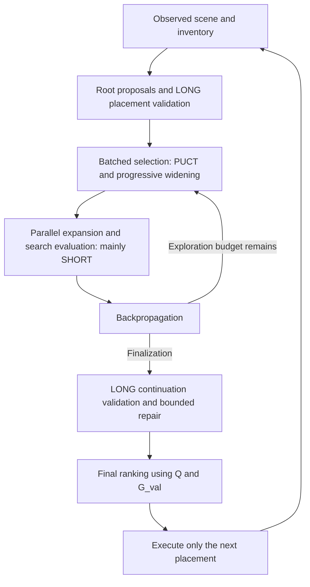

# 코드 프로젝트 전달: MCTS 탐색·경로 검증·최종 선택 정렬 및 benchmark

작성일: 2026-10-27\
대상: 별도 컴퓨터에서 실행 중인 stone-stacking 코드 프로젝트\
상태: 논문 프로젝트의 reference와 사용자 논의에 기반한 작업 요청. 원격 코드/실험 로그를 이번에 직접 확인한 결과가 아니다.

## 1. 이번 작업의 목적과 결정 사항

Short simulation, long validation, validated continuation return을 단순 구현 디테일로 축약하기 전에 이들의 역할과 효과를 확인한다. 핵심 가설은 다음과 같다.

1. 일반 탐색에서 비용이 낮은 평가를 사용하면, 같은 전체 planning 시간 안에 더 많은 유효 후보와 후속 배치를 탐색할 수 있다.
2. Root placement와 유망한 continuation의 추가 검증은 탐색 근사에서 놓친 불안정성 및 상태 오차를 걸러낼 수 있다.
3. 평균 탐색값 Q에 검증된 특정 경로의 return G_val을 결합하면, Q만 사용할 때와 다른 배치를 선택하고 최종 안정성/target coverage에 영향을 줄 수 있다.

아직 정량적으로 확인한 성능 향상은 없다. 사용자는 실제 실행에서 G_val 사용 여부의 차이 가능성을 관찰했지만, 검증된 결과로 주장하지 않는다. 속도·feasibility·ranking 효과를 분리하여 확인한 뒤 논문 강조점을 결정한다.

현재 요청은 **코드 감사 → 의미/설정 정렬 → 필요한 계측 → 실행 가능한 benchmark 계획과 smoke test**다. 실제 로봇을 움직이는 실험이나 대규모 sweep은 이번 전달만으로 실행하지 않는다. 논문 표현에 맞추려고 실제 알고리즘을 임의로 바꾸지 않는다.

## 2. 먼저 확인할 기준

- 실행 repository의 commit, dirty diff, 선택한 profile, runtime overrides, backend 및 resolved configuration을 기록한다. 문서의 기본값을 실제 실행값으로 간주하지 않는다.
- 아래 내용은 주로 2026-10-20의 MCTS/simulation 문서와 2026-10-26의 reward/sampling summary에 근거한다. 최신 코드와 차이가 있으면 file/function/조건 분기로 표를 작성한다.
- 이번 문서에 없는 timeout, retry 횟수, 모델 물성, score weight 등을 임의로 정하지 않는다.
- 현재 논문은 본문 5페이지를 목표로 한다. 모든 분기와 수치를 본문에 넣기보다, 결과를 바꾸는 결정 규칙을 명확히 쓰고 설정값/상세 절차를 별도로 관리한다.

우선 살펴볼 파일 이름은 기존 문서 기준이며 실제 repository 구조에 맞춰 찾는다:

```text
packages/stacking-common/src/stacking_common/search/tree_policy.py
packages/stacking-common/src/stacking_common/search/policies.py
packages/stacking-common/src/stacking_common/workflows/search.py
packages/stacking-common/src/stacking_common/environment/{reward,robustness}.py
apps/excavator/config/mcts_{cpu,cuda}.yml
apps/tabletop/config/...
```

Final selection, continuation validation/repair, simulation backend, backup 구현은 실제 호출 경로를 추적해서 찾는다. 위 목록이 전체 구현을 뜻하지 않는다.

## 3. 현재 이해한 동작 — 코드에서 확인할 사항

### 3.1 Progressive widening과 배치 선택

Non-root node의 선택 가능한 child 수 상한은 다음 일반형이다.

```text
K(n) = min(K_max, ceil(kappa * max(N_completed(n), 1)^alpha))
```

- K_max=16, kappa=3, alpha=0.5는 문서에 기록된 설정 예시이며 configurable하다. Root는 별도 child cap을 사용한다.
- K(n)는 node별 branching allowance다. 전체 시간 budget, evaluation batch size, proposal-attempt budget과 다르다.
- Temporary/virtual visits는 PUCT의 batch 배분에 사용하지만 widening allowance를 늘리지 않는다.
- 선택은 반드시 기존 leaf까지 내려가지 않는다. 내부 node에서도 새로운 proposal slot이나 pending action을 예약할 수 있다.
- Pending action 우선, generation-attempt 한도, exhaustion, 이미 예약된 용량을 함께 고려한다. 단순히 child 수가 K보다 작으면 무조건 expansion한다는 설명으로 바꾸지 않는다.
- Fresh proposal은 init → opt → sim 순서다. Cached optimized action은 simulation부터 시작할 수 있으며, 병렬성은 서로 다른 후보 사이에 있다.

### 3.2 Simulation: 무엇을 근사하고 무엇을 검증하는가

기본 단계는 다음과 같다.

1. 기존 scene을 고정하고 새 돌을 settling한다.
2. Structural simulation으로 안정화/물리적 적합성을 평가하고 settled successor s'를 얻는다.
3. s'에서 별도 velocity-disturbance trials를 시작해 robustness를 측정한다. Disturbance 결과가 nominal successor를 대체하지 않는다.

문서상 SHORT/LONG 차이는 단순한 실행 시간만이 아니다.

| 구분 | 문서상 동작 | 감사할 사항 |
|---|---|---|
| SHORT | 짧은 settling 기준과 시간 한도, 먼 기존 돌의 거리 기반 동결 가능, support chain 보존 | 실제 동적 body 집합, 종료/실패 이유, disturbance 적용 범위 |
| LONG | 더 긴 안정화 확인, 거리 기반 동결 해제 | 명시적 fixed body와 지면은 계속 고정될 수 있음 |
| 사용 위치 | 일반 descendant 탐색은 주로 SHORT, root 후보 및 최종 continuation은 LONG | depth별 fidelity 전환과 실제 runtime override |
| 재검증 | 부모 장면에서 transition을 다시 평가 | SHORT 최종 상태에서 단순히 시간을 더 적분하는지와 구분 |

문서상 LONG backend 내부의 short gate → long extension은 연속 적분이다. 반면 MCTS의 SHORT 평가 → LONG 재평가는 부모 장면에서 시작하는 별도 호출이다. 이 둘을 혼동하지 않는다.

SHORT가 실패한 child는 최종 LONG 검증 대상에서 제외되는 것으로 기록돼 있다. 따라서 LONG 검증이 SHORT의 모든 오판을 복구한다고 주장할 수 없다. 이는 benchmark의 중요한 감사 항목이다.

### 3.3 G_val의 생성과 최종 ranking

현재 배치 a0와 후속 배치 a1,...,ah로 구성한 검증 경로에 대해:

```text
G_val(a0) = r_val(a0) + gamma*r_val(a1) + ... + gamma^h*r_val(ah)
J(a0) = (1-beta)*Q(a0) + beta*G_val(a0)
```

- 현재 배치 reward도 포함한다. h는 현재 배치 이후의 검증 깊이이며 remaining depth/terminal에 의해 짧아질 수 있다. 문서의 CUDA 기본 h=2, beta=0.5는 고정 알고리즘 상수가 아니다.
- G_val은 LONG으로 검증된 경로의 reward 합이다. 이미 authoritative한 결과는 재사용한다. 경로합 자체에 leaf bootstrap을 추가하지 않는다.
- 초기 경로 검증은 기존 return 순서로 후보 경로를 확인하고 **처음 통과한 continuation**을 사용한다.
- Repair는 유효 prefix를 보존하고 새 후보를 SHORT screening → LONG validation하며, 확보한 authoritative continuation들 중 최대 return을 사용한다.
- 따라서 G_val을 검증한 모든 경로의 평균, 또는 가능한 모든 LONG 경로의 전역 최댓값으로 정의하면 안 된다.
- 재검증으로 상태가 크게 바뀌면 descendants를 폐기한다. Parent/child state version이 다른 reward들을 하나의 경로로 연결하지 않는지 확인한다.
- Q는 SHORT 결과, 탐색 중 실패, bootstrap, 탐색 분배 및 일부 LONG backup의 영향을 받는 평균값이다. Repair 결과가 backup되면 Q도 변할 수 있다. G_val과 완전히 독립적인 통계라고 가정하지 않는다.
- 기본 root 준비를 거친 후보의 mean score는 Q이지만, 다른 진입 경로에서 final-validation reward를 mean score로 사용하는 fallback이 문서에 있다. 실제 예외 경로를 확인한다.
- Validated continuation이 없는 경우 repair/retry 이후에는 **현재 배치 자체가 물리 검증을 통과한 root** 중 mean score로 fallback할 수 있다. 모든 실행 action에 검증된 continuation이 있다고 보장하지 않는다.
- 실행하는 것은 다음 배치 하나다. 후속 경로는 예측이며 관측 상태를 반영해 다시 계획한다.

## 4. 코드 정렬과 계측 우선순위

### A. 먼저 결과를 바꾸지 않는 정렬

1. Child cap, widening coefficient/exponent, batch size, attempt cap, time budget을 서로 다른 설정/로그로 구분한다.
2. 각 transition에 평가 종류(SHORT/LONG), parent-state 식별자/version, validity/rejection reason, settled successor, reward 및 구성항을 추적할 수 있게 한다.
3. Root action별 Q, visit count, G_val, beta, J, validation depth, 선택된 path IDs, 각 step의 discount/reward, 최초 검증/repair 여부를 기록한다.
4. Cached LONG 결과의 유효성 조건과 state-drift invalidation을 확인한다. 다른 parent state에서 얻은 결과를 무조건 재사용하지 않는다.
5. 서로 같은 장면/profile에서 기존 동작이 유지되는지 작은 deterministic 또는 seeded smoke test로 확인한다. 실험용 분기 때문에 기본 policy가 바뀌지 않아야 한다.

### B. 반드시 분리해서 제어할 실험 축

- Search evaluation: SHORT 또는 LONG.
- Final continuation validation: 수행 여부와 depth.
- Continuation requirement / admissible root 집합 / fallback 정책.
- Repair: 수행 여부와 budget.
- Ranking: Q-only / mixed / 필요하면 path-only.

문서상 `mean` mode는 G 항만 제거하지 않고 descendant-path scoring과 repair도 우회한다. 단순 mean-vs-mixed를 G_val 단독 ablation이라고 부르지 않는다. `beta=0`도 내부 분기가 같다는 보장이 없으므로 확인한다.

실험용 설정을 추가해야 한다면 기존 기본값은 보존하고, 위 축들을 명시적으로 고정할 수 있는 최소 변경을 제안/구현한다. 현재 first-passing-path와 repair-max의 비대칭을 임의로 통일하지 말고, 먼저 로그와 의미를 정리한다.

## 5. Benchmark: 작은 진단부터 전체 성능까지

### 단계 0: 재현 가능한 작은 테스트

- 하나의 저장된 scene/inventory와 resolved profile을 고정한다.
- 실행 가능한 CLI/config를 찾아 짧은 dry-run/smoke command를 제시한다. 명령을 추측해서 문서에 쓰지 않는다.
- G_val이 path reward의 할인합과 맞는지, terminal truncation, authoritative cache reuse, 상태 drift, no-path fallback, repair budget 제한을 작은 케이스로 확인한다.
- 물리적 실패와 timeout/unsettled/no-continuation을 구분한다. No continuation은 feasible한 후속 경로가 존재하지 않는다는 증명이 아니다.

### 단계 1: 동일 후보의 SHORT/LONG 비용과 판정 차이

동일 parent scene, 동일 pose-optimized candidate, 동일 물성과 가능한 경우 동일 disturbance random draws에서 각각 평가한다. 쉬운 바닥 배치와 하중 전달이 복잡한 구조를 포함해 scene 높이/접촉 수/물체 수별로 기록한다.

측정:

- 전처리·settling·structural·disturbance 단계 시간, end-to-end batch 시간, 성공 후보 처리량
- 실제 적분 step 수, 동적 body/contact 수, batch 점유율
- SHORT accept / LONG reject 및 SHORT reject / LONG accept 빈도, 실패 이유
- successor 위치·회전 차이와 reward 차이

진단용으로 SHORT에서 탈락한 후보도 표본 추출해 별도 평가한다. LONG은 절대적인 물리 정답이 아니라 공통 비교 기준이다. LONG이 동일 short gate로 조기 종료한다면 공유된 gate의 오판은 이 비교로 발견할 수 없다. 필요한 경우 별도로 명시한 audit validator(예: 다른 종료 기준/동적 body 범위)나 독립 실험을 사용하고, 이를 운영 LONG과 구분한다. 실패를 통과시키기 위해 운영 validator를 몰래 완화하지 않는다.

### 단계 2: G_val의 ranking 효과 분리

먼저 동일 search snapshot에 대해 동일 validation/repair를 한 번 수행하고, 동일한 후보·검증 경로·Q snapshot을 저장한다. 이 데이터에서 ranking만 바꾼다.

| 비교 | 동일하게 유지할 것 | 바꿀 것 |
|---|---|---|
| Q-only vs mixed | tree, 검증/repair 결과, eligible root 집합, fallback, Q가 읽히는 시점 | 최종 점수 Q 또는 (1-beta)Q+beta G_val |
| 선택적 beta sweep | 위와 같음 | beta와 선택 action |

Action 변경률, 순위 역전, Q/G_val 차이, 선택된 경로 depth를 기록한다. 동일한 G_val을 평가 지표로 써서 mixed가 좋다고 결론내리지 않는다. 선택된 서로 다른 action은 독립적인 simulation rollout/공통 validation protocol 또는 실제 실행으로 평가한다.

이 실험은 의사결정 차이를 분리하는 진단이다. 이후 관측/재계획으로 trajectories가 달라지는 전체 stacking 성능까지 단독으로 증명하지 않는다. Q와 G_val의 유효 horizon 및 scale 차이도 함께 확인한다.

### 단계 3: 전체 planning budget을 맞춘 stacking 비교

최소 핵심 비교는 아래와 같다. 모두 동일 hardware/backend, scene·inventory·target suite, 공통 최종 평가 기준을 사용한다.

| 실험 | Search simulation | Final continuation validation / repair | Ranking | 주된 비교 목적 |
|---|---|---|---|---|
| LQ | LONG | SQ와 동일 | Q-only | LQ vs SQ: 탐색 근사 사용의 비용/품질 tradeoff |
| SQ | SHORT | 유지 | Q-only | 검증은 유지하고 평균값으로 선택 |
| SM | SHORT | SQ와 동일 | mixed | SQ vs SM: 경로값을 ranking에 사용하는 효과 |
| S0 (후속) | SHORT | root placement 검증은 유지, continuation 검증/repair 생략 | Q-only | S0 vs SQ: continuation 검증·repair 묶음의 효과 |

SQ/SM에서 validation/repair가 동일하다는 것은 policy·budget·eligibility가 같다는 뜻이다. 실제 end-to-end 실행은 선택 action 이후 장면이 달라지므로 이후 모든 후보가 같을 수는 없다. 단일 결정의 엄밀한 통제는 단계 2에서 한다.

S0는 검증과 repair를 동시에 제거한 package comparison이다. 각각의 효과가 필요하면 repair만 끈 중간 변형을 추가하되, 처음부터 모든 조합을 크게 돌리지 않는다.

**예산/평가 규칙**

- 전체 wall-clock budget에 root generation/validation, pose optimization, exploration, final validation/repair, retries와 fallback을 모두 포함한다. 동일 iteration 수만으로 공정성을 주장하지 않는다.
- 필요하면 같은 수의 후보 평가에 드는 비용도 보조 측정하되, 전체 시스템 결론은 동일 시간 조건으로 낸다. Deadline 초과와 미완료/실패 run을 누락하지 않는다.
- Warmup/JIT, GPU 동기화/비동기 timing, batch overhead의 포함 범위를 기록한다. 기존 CPU/CUDA profile은 depth와 후보 수 등이 다르므로 그대로 비교해 parallelization 단독 speedup이라고 부르지 않는다.
- SHORT도 초기 settling과 disturbance 비용을 공유한다. Structural simulation의 시간 감소가 전체 MCTS에서 같은 배율의 speedup이 된다고 가정하지 말고, pose optimization을 포함한 단계별 시간 비율을 확인한다.
- 기존 global/adaptive weights, sampler, pose optimization, inventory, disturbance 모델은 비교 중 고정하고 모든 override를 저장한다.
- 작은 pilot로 로그·실패 양상·실행 시간을 확인한 뒤 scene/seed 반복 수와 전체 sweep 규모를 정한다. 평가 seed/scene을 보고 beta를 튜닝하지 않는다.

**주요 결과**

- 독립 평가에서의 stability/failure, 최종 target coverage와 완료한 배치 수
- 전체 구조의 union 기반 coverage 등 실제 task 지표. 내부 reward가 높다는 것만으로 우수성을 주장하지 않는다.
- 전체 planning 시간과 phase별 시간, 유효 후보/초, 도달 깊이와 unique evaluated states
- Validated-continuation 확보율, fallback/repair/retry 빈도, SHORT→LONG 탈락률, state drift
- Q/G_val ranking 변경률 및 선택 action 변경률

실물 평가는 이후 같은 관측/replanning protocol로 수행한다. DSF approximation과 simulation parameter에 대한 의존성은 LONG으로도 제거되지 않는다.

## 6. 코드 프로젝트에서 반환해 줄 결과

1. **Alignment report:** 위 항목별 현재 코드 동작, 문서와의 차이, 수정 여부, file/function 근거.
2. **설정 표:** actual resolved profile과 실험 축별 override. 원래 기본값과 benchmark-only 변경을 구분.
3. **계측/테스트 결과:** 작은 케이스의 G_val 계산, 동일 parent-state 경로, cache/drift/fallback 확인.
4. **실행 문서:** 검증된 smoke 명령, pilot 명령, 출력 디렉터리/결과 schema, 예상 비용은 측정 근거와 함께 제시.
5. **Benchmark 계획:** 우선 실행할 LQ/SQ/SM 및 후보 단위 진단, 이후 S0/repair 분리 여부. 대규모 실행은 별도 결정.
6. **논문용 요약:** 확인된 사실, 미검증 가설, 구현 한계와 주장 가능한 효과를 분리해서 반환.

## 7. 논문과 overview에 반영할 방향

코드 확인 이후 다음 논리로 본문을 정렬한다.

- Simulation module: settling → structural response → successor / disturbance의 기본 interface를 설명하고, SHORT가 적분/동적 범위를 줄이는 평가이며 LONG이 root 및 유망한 continuation을 추가 검증한다는 역할을 명시한다. 정확한 시간·반경 등은 설정으로 분리한다.
- Overview/MDP: 단일 transition F 표기를 유지하더라도 탐색 중에는 근사 평가를 사용한다고 명시한다. SHORT와 LONG이 항상 같은 successor를 만드는 하나의 정확한 deterministic transition인 것처럼 서술하지 않는다.
- MCTS: widening의 역할과 configurable cap을 설명한다. 최종 선택에서 검증된 경로의 G_val과 Q의 혼합을 정의한다. First-passing vs repair-max, fallback은 구현과 맞는 범위로 압축한다.
- Overview: 기존 selection → parallel expansion/evaluation → backpropagation 반복은 유지한다. 평가 부분에 `SHORT: search evaluation`을 표시하고, 별도 하단 흐름으로 `LONG continuation validation → Q/G_val ranking → execute next placement`를 둔다. Root action도 탐색 전에 LONG을 받는 예외는 작은 annotation 또는 caption으로 명시한다.
- 최종 검증에 실패할 때의 bounded repair를 작은 feedback으로 표시하되, 전체 search loop로 무제한 돌아가는 그림을 만들지 않는다. 실행 후 observed scene으로 replanning한다는 큰 흐름과 구분한다.
- SHORT/LONG은 simulation fidelity/effort이며 MCTS의 lookahead depth와 다르다. LONG을 real-world stability 보장이나 ground truth라고 부르지 않는다.
- `short simulation으로 속도가 크게 향상됐다`는 결과 문장은 benchmark 전에는 쓰지 않는다. 현재는 `탐색 비용을 줄이고 유망한 경로에 검증 계산을 집중하도록 설계했다`는 의도와 검증 가설로 기술한다.

본문 분량과 그림 글자 크기를 고려해 기존 overview 오른쪽에 좁은 panel을 계속 추가하기보다, 작은 출력 상자를 하단의 validation/selection 흐름으로 확장하는 구성을 우선 검토한다.

개념적 흐름(최종 그림의 박스 수를 그대로 지정하는 것은 아님):



그림의 validation/repair block은 필요한 후보를 추가 생성하는 처리도 포함한다. Fallback으로 continuation이 없는 경우에는 G_val 혼합 ranking 대신 검증된 root의 mean score로 선택한다는 예외를 caption이나 본문에 남긴다.

## 참고: 논문 프로젝트의 관련 문서

이 전달 문서는 독립적으로 읽을 수 있도록 작성했다. 추가 근거가 필요하면 논문 프로젝트에서 다음 파일을 함께 전달한다.

- `.ref/mcts-strategy.md`
- `.ref/mcts-simulation.md`
- `.ref/mcts-batching.md`
- `.ref/mcts-algorithm-appendix.md`
- `.ref/mcts-reward-and-pose-sampling-summary.md`
- `.ref/rss2027-review-remaining.md` 23–25절
